# Auditoría Visual y de Usabilidad — MyDamnManagement (`release/v1.0`)

Esta auditoría evalúa el estado real de la interfaz en `frontend/index.html` (1.007 líneas) y `frontend/app.js` (2.565 líneas), verificando la aplicación levantada en navegador con datos sembrados (páginas anidadas, notas con bloques ricos y wikilinks, y bases de datos con 9 filas en vista tabla y tablero Kanban) a **1280×800 px** y **1024×768 px**, tanto en modo claro como oscuro.

---

## 1. Evidencia visual (capturas del estado actual)

Todas las capturas se encuentran en `docs/diseno/capturas/`:

| Captura | Vista y condición |
| :--- | :--- |
| 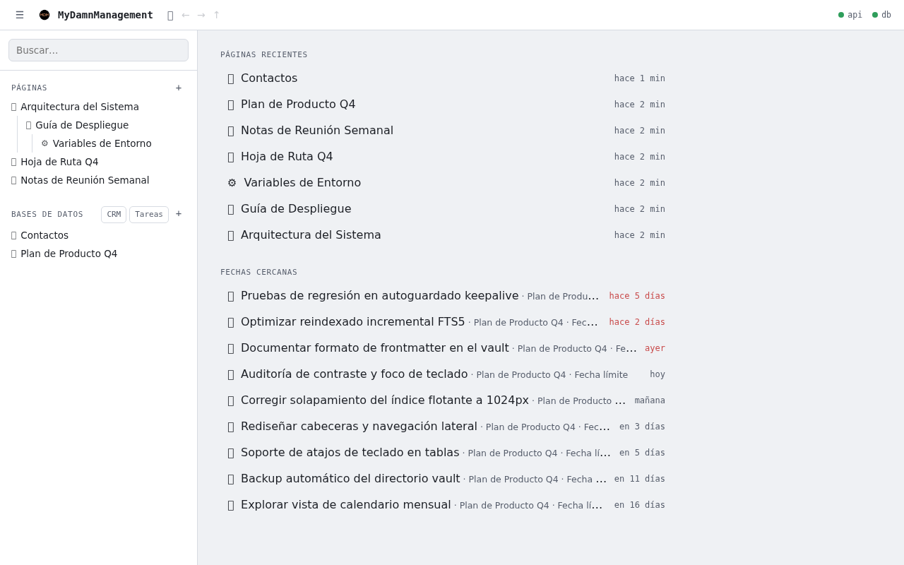 | `01-dashboard-panel-notas.png` — Inicio (`renderDashboard`), barra lateral con árbol de páginas y bases de datos a 1280×800 px. |
| 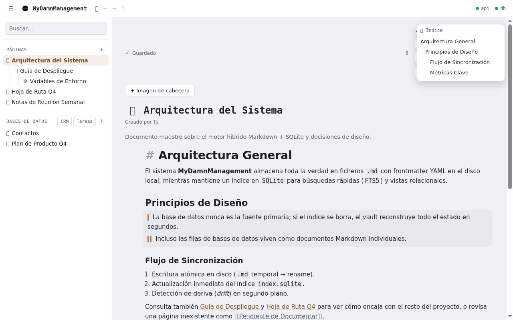 | `02-nota-abierta-1280px.png` — Nota abierta con índice flotante y desplegable de backlinks abiertos a 1280×800 px. |
| 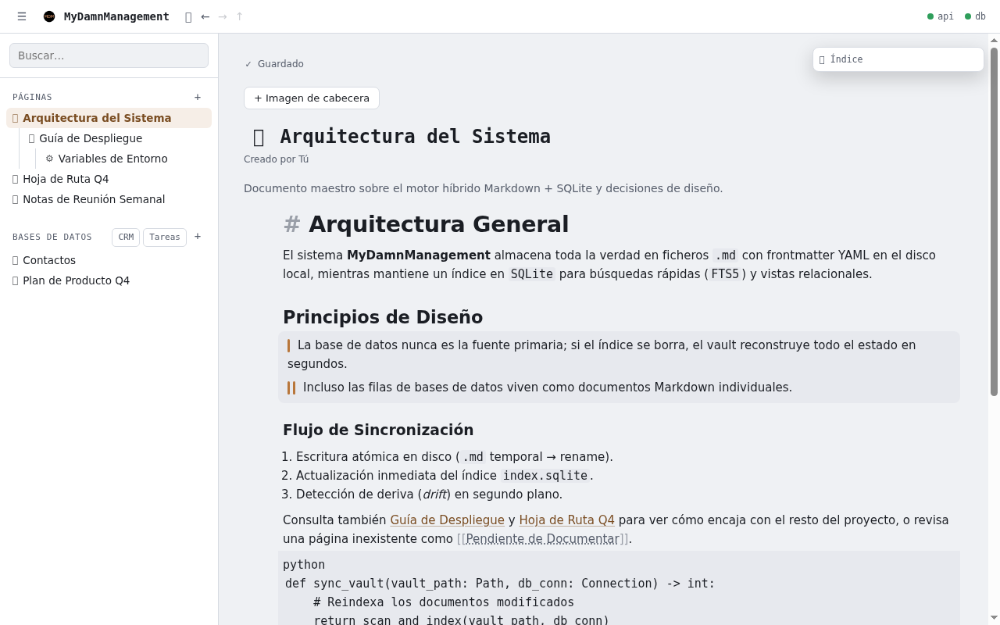 | `09-nota-colision-indice-backlinks.png` — Estado por defecto al abrir una nota con encabezados: `.note-outline-dropdown` (`position: fixed`) pisa literalmente el resumen `Backlinks (3)` y el botón de exportar `⇩`. |
| 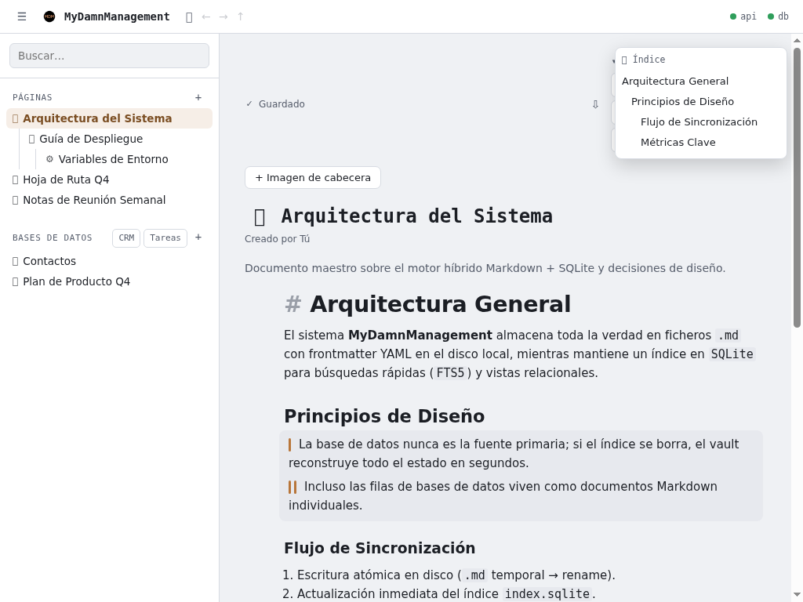 | `03-nota-abierta-1024px-solapamiento.png` — Nota abierta a 1024×768 px mostrando la colisión en la esquina superior derecha y el ancho de línea sin acotar. |
| 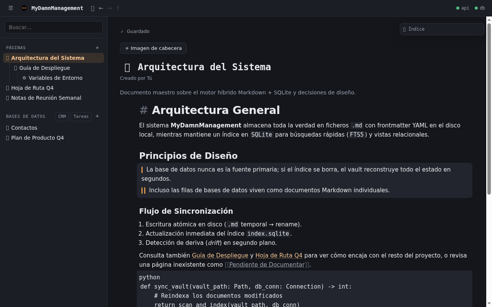 | `10-nota-modo-oscuro.png` — Nota abierta bajo `prefers-color-scheme: dark`. |
| 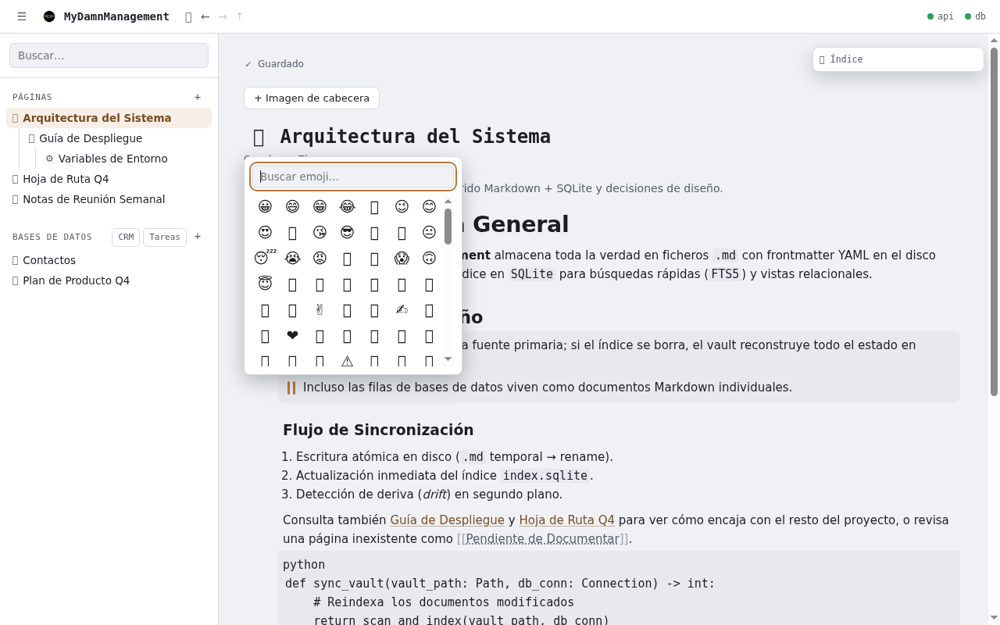 | `11-nota-selector-emoji.png` — Flotante `.mdm-emoji-picker` abierto sobre la nota. |
| 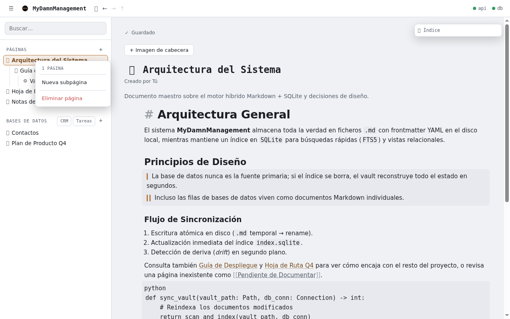 | `12-menu-contextual-arbol.png` — Menú contextual `.mdm-context-menu` al hacer clic derecho en la barra lateral. |
| 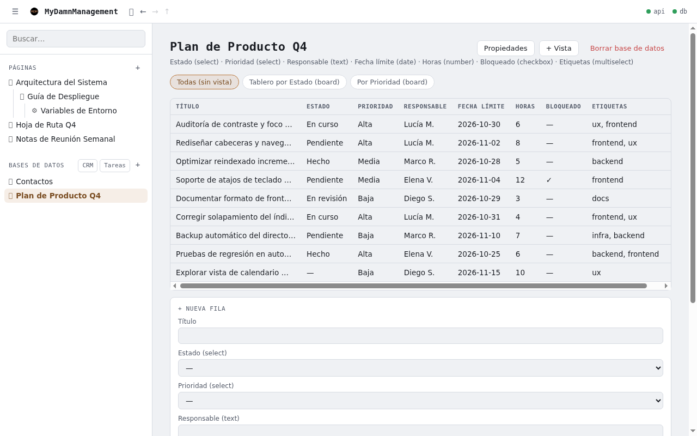 | `04-base-datos-tabla-1280px.png` — Vista de tabla (`.rows-table`) + formulario inferior `.inline-form` a 1280×800 px. |
| 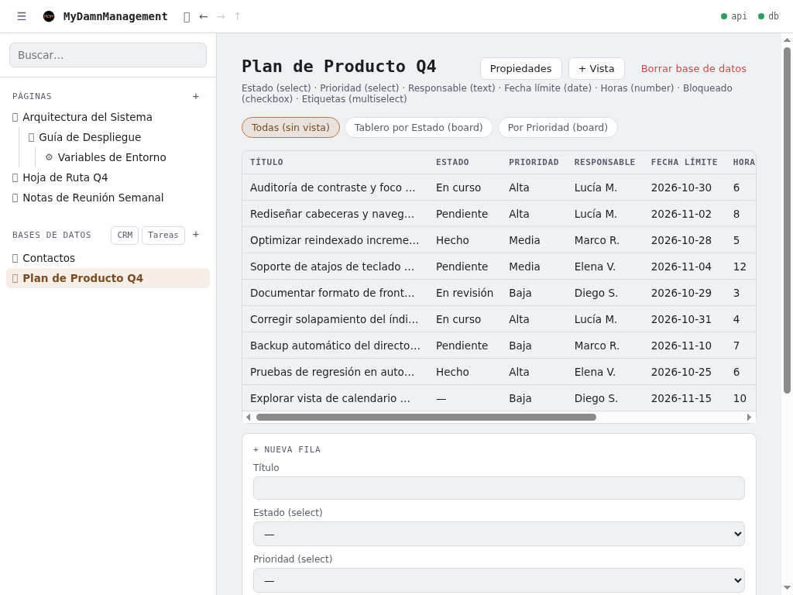 | `05-base-datos-tabla-1024px.png` — Vista de tabla a 1024×768 px (`clientWidth: 663px` frente a `scrollWidth: 947px`, cortando 3 columnas y el botón de borrado). |
| 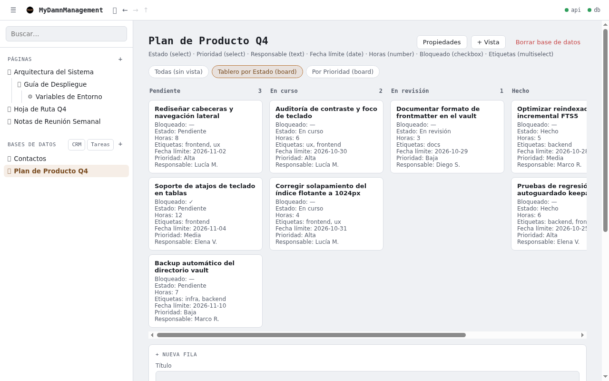 | `06-tablero-kanban-1280px.png` — Vista de tablero Kanban (`.board`, `.board-col`, `.board-card`) a 1280×800 px. |
| 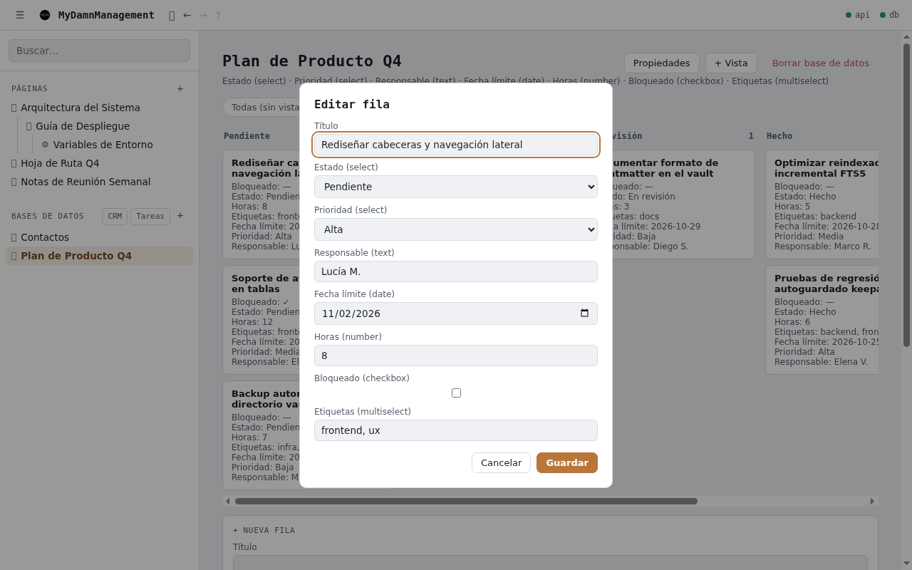 | `07-modal-editar-fila.png` — Modal `<dialog id="dialog-row">` al hacer clic en una tarjeta del tablero. |
| 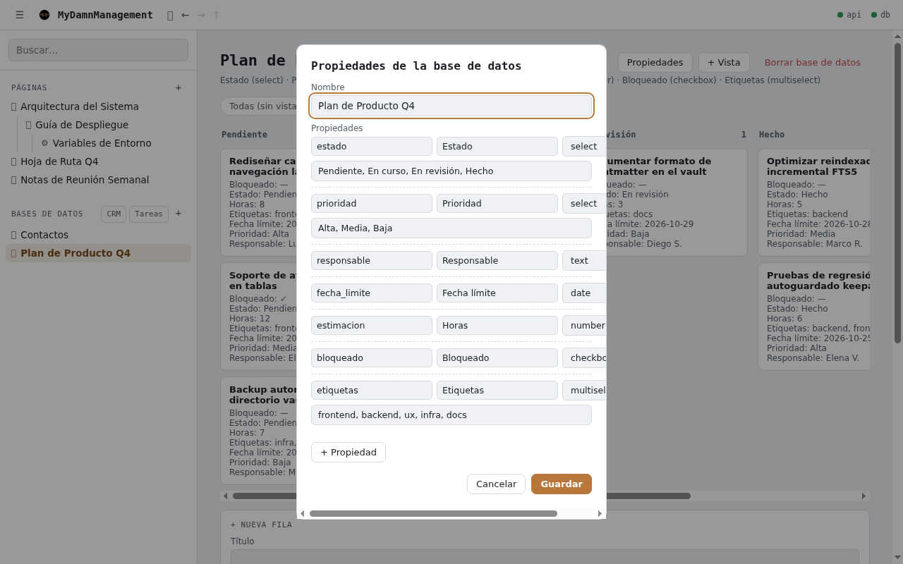 | `08-modal-propiedades-db.png` — Modal `<dialog id="dialog-database">` de esquema y propiedades. |

---

## 2. Qué está bien hoy (y no debe romperse)

- **Contraste de texto principal y secundario (WCAG AAA / AA holgado):**
  - Modo claro: `--ink` (`#1b1e24`) sobre `--panel` (`#ffffff`) da **16.70:1** y sobre `--bg` (`#eff1f4`) da **14.75:1**. `--ink-muted` (`#565d6b`) sobre `--panel` da **6.62:1** y sobre `--bg` da **5.85:1**. `--accent-ink` (`#7a4d22`) sobre `--panel` da **7.21:1** y sobre `--accent-soft` da **6.32:1**.
  - Modo oscuro: `--ink` (`#e7e9ed`) sobre `--bg` (`#14161b`) da **14.89:1** y sobre `--panel` (`#1b1e25`) da **13.72:1**. `--ink-muted` (`#9aa1af`) sobre `--panel` da **6.43:1**.
- **Anillo de foco en elementos nativos:** `frontend/index.html:60` define `:focus-visible { outline: 2px solid var(--accent); outline-offset: 2px; }`. Cuando un `<button>`, `<input>` o `<select>` nativo recibe foco por teclado, el anillo es claro.
- **Soporte de `prefers-reduced-motion`:** `frontend/index.html:281-283` detiene el giro de `.spinner` y `frontend/index.html:889-892` desactiva la animación de `.error-toast` y aplica `* { transition: none !important; }`.
- **Números tabulares donde importan:** `.note-savestatus`, `.note-meta` y `.rows-table th, .rows-table td` declaran `font-variant-numeric: tabular-nums` (`frontend/index.html:267, 397, 766`), evitando saltos horizontales al actualizar contadores o fechas.
- **Diálogos nativos `<dialog>`:** `dialog-database`, `dialog-view` y `dialog-row` se abren con `.showModal()`, lo que gestiona el cierre con `Escape` y el bloqueo del fondo (`::backdrop`) sin librerías externas.

---

## 3. Hallazgos clasificados por gravedad

### A. ROMPE EL USO (impide operar con teclado, tapa controles o incumple accesibilidad básica)

#### 1. Navegación por teclado rota en toda la estructura principal (`div` interactivos sin `tabindex` ni `role`)
- **Dónde vive:**
  - Árbol lateral: `frontend/app.js:372-410` (`.tree-row` creado como `
` con `addEventListener("click")`) y `frontend/index.html:166-177`.
  - Inicio / Dashboard: `frontend/app.js:219-243` (`.dashboard-item` creado como `
`) y `frontend/index.html:238-245`.
  - Vista Tabla (celdas editables): `frontend/app.js:1855-1863, 1888-1896` (`<td>` con `td.onclick = ...`).
  - Vista Tablero Kanban: `frontend/app.js:2042-2079` (`.board-card` creado como `
` con `card.addEventListener("click", ...)`).
  - Índice de la nota y resultados de búsqueda: `frontend/app.js:736-744` (`.note-outline-item`), `frontend/app.js:811-815` (`.backlink-item`) y `frontend/app.js:2493-2502` (`.search-hit`).
- **Evidencia medida:** Al recorrer la vista de una nota con `Tab`, el navegador salta de `#btn-new-database` en la barra lateral directamente al botón `⇩` de la nota, **ignorando las 7 filas `.tree-row` del árbol lateral** (`0` de `7` tienen `tabindex`). En el tablero Kanban, ninguna tarjeta `.board-card` es alcanzable con `Tab`. En la tabla, ninguna celda `<td>` se puede enfocar ni activar con `Enter`/`Espacio`: un usuario de teclado solo puede clicar el botón `🗑` (`.row-del`) para borrar la fila, pero no puede editar ninguna celda.

#### 2. El índice flotante (`.note-outline-dropdown`) tapa físicamente los controles de `Backlinks` y `Exportar`
- **Dónde vive:** `frontend/index.html:302-315` (`.note-outline-dropdown { position: fixed; top: 60px; right: 20px; z-index: 900; width: 220px; }`) frente a `frontend/index.html:254-270` (`.note-topbar` y `.note-topbar-right`).
- **Evidencia medida (capturas `09-nota-colision-indice-backlinks.png`, `02-nota-abierta-1280px.png` y `03-nota-abierta-1024px-solapamiento.png`):**
  - En una ventana de `1280×800 px`, el botón de exportar `⇩` ocupa `x: 1095..1115, y: 72..92` y el desplegable `Backlinks (3)` ocupa `x: 1125..1233, y: 75..89`.
  - El panel `.note-outline-dropdown` (incluso cerrado) es una caja `position: fixed` con fondo opaco `var(--panel)` y `z-index: 900` que ocupa **`x: 1040..1260, y: 60..92`**.
  - Resultado: **cubre el 100% del área de clic tanto del botón de exportar (`⇩`) como del desplegable `Backlinks (3)`** cuando la nota está arriba del todo (`scrollTop === 0`). No se puede hacer clic en `Backlinks` ni en `Exportar` sin hacer scroll hacia abajo primero. A `1024 px` de ancho ocurre exactamente el mismo bloqueo (`topbarRight` en `x: 749..977, y: 71..194` tapado por `outlineDropdown` en `x: 784..1004, y: 60..203`).

#### 3. Controles invisibles al teclado y exclusivamente dependientes de `:hover` de ratón (asas de bloque `+` y `⋮⋮`)
- **Dónde vive:** `frontend/index.html:541-555` (`.cm-mdm-block-handle-wrap { opacity: 0; }` y `#note-body .cm-line:hover .cm-mdm-block-handle-wrap { opacity: 1; }`).
- **Evidencia medida:**
  - Los controles `.cm-mdm-block-add` (`+`) y `.cm-mdm-block-handle` (`⋮⋮`) miden **`18×24 px`** cada uno (`frontend/index.html:564`: `width: 18px; font-size: 15px; line-height: 1.6`).
  - Carecen de regla `:focus-within` y no son alcanzables por teclado, y en pantallas táctiles o al usar teclado permanecen en `opacity: 0`.
  - Cuando aparecen al hacer hover sin poner el cursor encima del icono exacto, tienen `color: var(--ink-muted); opacity: 0.55` (`frontend/index.html:568-569`), lo que arroja un contraste real de **2.32:1** en modo claro (`#eff1f4`) y **2.96:1** en modo oscuro (`#14161b`), por debajo del mínimo de **3.0:1** para controles de interfaz (WCAG 1.4.11).

#### 4. Áreas de toque / clic minúsculas (por debajo del mínimo de 24×24 px de WCAG 2.2 AA y lejos de 32–44 px)
- **Dónde vive y medidas reales en DOM:**
  - `.icon-btn` (`frontend/index.html:133-145`): **`20×20 px`**. Se usa en los botones más frecuentes de toda la app: `#btn-toggle-sidebar` (`☰`), `#btn-nav-home` (`🏠`), `#btn-nav-back` (`←`), `#btn-nav-forward` (`→`), `#btn-nav-up` (`↑`), `#btn-new-note` (`+`), `#btn-new-database` (`+`), botón exportar nota (`⇩`) y botón quitar propiedad en el modal (`×`). Además, en `.nav-history-controls` (`frontend/index.html:152`) están separados por apenas `gap: 2px`, facilitando clics erróneos.
  - `.row-del` (`frontend/index.html:800`): **`19.8×17 px`** (sin `padding`, alto ni ancho mínimo declarados) para una acción destructiva (`🗑` borrar fila de la tabla).
  - `.error-toast-close` (`frontend/index.html:872-882`): **`13×15 px`** (`padding: 0 3px; font-size: 15px`).
  - `.note-header-remove` (`frontend/index.html:348-355`): `padding: 0; font-size: 12px` (**`15 px` de alto**).

#### 5. Contraste insuficiente en el botón primario (`.btn-primary`) en ambos modos
- **Dónde vive:** `frontend/index.html:15, 32, 195-212` (`font-size: 13px` heredado de `.btn` en `:196`, y `.btn-primary { background: var(--accent); color: #fff; font-weight: 600; }` en `:206-212`).
- **Evidencia medida:**
  - **Modo claro:** texto blanco `#ffffff` (13 px) sobre `--accent` (`#b8763a`) tiene un ratio de contraste de **3.69:1** (incumple WCAG AA para texto normal, que exige **4.5:1**).
  - **Modo oscuro:** texto blanco `#ffffff` (13 px) sobre `--accent` (`#e0994f`) cae a **2.38:1** (ilegible e incumple incluso el umbral de texto grande de 3.0:1; además usa texto blanco sobre un naranja pastel luminoso en vez de texto oscuro `#14161b` que daría **7.62:1**).

---

### B. ESTORBA (degrada la lectura, añade fricción innecesaria o rompe la maquetación a 1024 px)

#### 6. Modal de propiedades de base de datos estrecho (`440 px`) y sin control de desbordamiento
- **Dónde vive:** `frontend/index.html:821-835` (`dialog { width: min(440px, 92vw); }` y `.prop-row { grid-template-columns: 1fr 1fr 100px auto; gap: 6px; }`).
- **Evidencia medida (captura `08-modal-propiedades-db.png`):**
  - El diálogo mide solo `440 px` de ancho (`398 px` útiles descontando `padding: 20px`) para embutir una rejilla de 4 columnas (`clave`, `Nombre visible`, `tipo` de 100 px y botón `×`).
  - Cada input de clave y nombre queda reducido a **~130 px de ancho**, cortando textos moderados, y `#prop-rows` carece de `max-height` con `overflow-y: auto`, por lo que una base con más de 8 propiedades desborda la altura de la ventana.

#### 7. Formulario `.inline-form` ("+ Nueva fila") gigantista y permanente debajo de cada vista de base de datos
- **Dónde vive:** `frontend/index.html:803-818` y `frontend/app.js:1708, 2165-2224` (`renderAddRowForm`).
- **Evidencia medida (capturas `04-base-datos-tabla-1280px.png` y `06-tablero-kanban-1280px.png`):**
  - Tanto en la vista de Tabla como en la de Tablero Kanban, la app estampa siempre al final un formulario vertical de una sola columna (`.inline-form`) con todos los campos del esquema desplegados.
  - En una base de datos de 7 propiedades, `.inline-form` mide **`921×541 px`** (más alto que la propia tabla de 9 filas, que mide `921×353 px`).
  - Los inputs (`input[type="text"]`, `select`, `input[type="date"]`) se estiran a **`891 px` de ancho** (`width: 100%` de `#main`), obligando al ojo a viajar de extremo a extremo de la pantalla y desplazando el botón `"Añadir fila"` hasta `y: 1220 px` (fuera del viewport inicial de 800 px).

#### 8. Comportamiento a 1024 px: barra lateral fija de 280 px comprime la tabla y el tablero Kanban
- **Dónde vive:** `frontend/index.html:90-98` (`aside { width: 280px; flex-shrink: 0; }`), `frontend/index.html:104-109` (`main { padding: 28px 32px 60px; }`) y `frontend/index.html:777-778` (`.board-col { flex: 0 0 240px; }`).
- **Evidencia medida (captura `05-base-datos-tabla-1024px.png`):**
  - A `1024 px` de ancho, `aside` consume `280 px` y el padding horizontal de `main` consume `64 px`, dejando solo **`680 px`** (`663 px` dentro de `.table-wrap`) para el contenido principal.
  - En la vista de tabla (`scrollWidth: 947 px`), se pierde el **30% horizontal de la tabla** (`284 px` ocultos en scroll horizontal sin ningún indicador visual de desbordamiento ni sombra lateral), quedando ocultas las columnas `Horas`, `Bloqueado`, `Etiquetas` y el botón `🗑` de eliminar fila.
  - En la vista de tablero Kanban (5 columnas de `240 px` + `14 px` de gap = `1256 px`), a `1024 px` solo caben 2,5 columnas visibles y las columnas no tienen contenedor visual propio (fondo ni borde) que delimite dónde soltar una tarjeta al arrastrar.

#### 9. Prosa y títulos de nota sin ancho máximo de lectura (`max-width`)
- **Dónde vive:** `frontend/index.html:104-109` (`main`), `frontend/index.html:373-395` (`.note-title`, `.note-description`) y `frontend/index.html:414-422` (`#note-body .cm-content`).
- **Evidencia medida:** Mientras que `.dashboard` sí limita su ancho a `max-width: 640px` (`frontend/index.html:229`), la vista de nota ocupa el 100% de `#main`. A `1280 px` con la barra lateral abierta, `.cm-content` mide **`921 px` de ancho** (~115–125 caracteres por línea a `15px`), y si el usuario colapsa la barra lateral sube a **`1216 px`** (~155 caracteres por línea), muy por encima del rango ergonómico de lectura (65–75 caracteres / `680–740 px`).

#### 10. Contraste insuficiente en bordes estructurales (`--panel-border`), marcadores Markdown (`.cm-mdm-mark`) y color de peligro sobre fondo general
- **Dónde vive:**
  - `--panel-border`: `#d7dbe2` en modo claro (`frontend/index.html:12`) y `#2c303a` en modo oscuro (`frontend/index.html:29`).
  - `.cm-mdm-mark, .cm-mdm-wikimark`: `color: var(--ink-muted); opacity: 0.55` (`frontend/index.html:437`).
  - `--down`: `#c94c4c` en modo claro (`frontend/index.html:19`).
- **Evidencia medida:**
  - `--panel-border` (`#d7dbe2`) sobre `--bg` (`#eff1f4`) tiene un contraste de solo **1.23:1** (y sobre `--panel` `#ffffff` de **1.39:1**). En modo oscuro (`#2c303a` sobre `#1b1e25`) es **1.26:1**. Esto hace que los bordes de inputs (`.sidebar-search input`, `.field input`, `border: 1px solid var(--panel-border)` sobre fondo `var(--bg)`) prácticamente desaparezcan (**1.23:1**, muy lejos del **3.0:1** recomendado para bordes de controles).
  - `.cm-mdm-mark` con `opacity: 0.55` sobre `--bg` (`#eff1f4`) cae a **2.32:1** en modo claro y **2.96:1** en modo oscuro: cuando el usuario está editando una línea y necesita ver los símbolos `#`, `**` o `[[`, cuestan de leer.
  - `--down` (`#c94c4c`) sobre `--bg` (`#eff1f4`) —usado en `.dashboard-item-meta.overdue` (`frontend/index.html:251`), `.note-savestatus.is-error` (`frontend/index.html:269`) y `.btn-danger` (`frontend/index.html:213`)— da **4.02:1**, quedándose por debajo del umbral AA de **4.5:1** para texto de `12px–13px`.

#### 11. Ausencia de jerarquía visual en celdas de tabla y tarjetas de Kanban
- **Dónde vive:** `frontend/index.html:761-775` (`.rows-table`), `frontend/index.html:788-799` (`.board-card`) y `frontend/app.js:1711-1716, 2050-2057`.
- **Evidencia medida:**
  - En `.rows-table`, todas las columnas tienen exactamente el mismo peso tipográfico (`13.5px`, `font-weight: 400`). La primera columna (`Título` de la fila) no se distingue de una columna de texto normal, y las propiedades `select` / `multiselect` (`Estado: En curso`, `Prioridad: Alta`, `Etiquetas: ux, frontend`) se pintan como texto plano separado por comas en lugar de etiquetas visuales o pastillas diferenciables.
  - En `.board-card`, todas las propiedades se vuelcan como líneas de texto plano `.board-card-prop` (`Estado: En curso`, `Prioridad: Alta`, `Responsable: Lucía M.`, `Fecha límite: 2026-10-30`, `Horas: 6`), repitiendo incluso la propiedad por la que ya está agrupada la columna (`Estado: En curso` dentro de la columna `En curso`).
  - Las columnas `.board-col` no tienen fondo, borde ni indicador visual al arrastrar una tarjeta encima (`dragover` en `frontend/app.js:2029` no añade ninguna clase CSS de *drop target*).

---

### C. COSMÉTICO (detalles de acabado, consistencia visual y pulido)

#### 12. Inconsistencia entre el lienzo de la nota (`--bg`) y las superficies de lectura (`--panel`)
- **Dónde vive:** `frontend/index.html:45, 94, 104-109`.
- **Detalle:** La cabecera (`header`) y la barra lateral (`aside`) tienen fondo blanco (`--panel: #ffffff`), mientras que el área principal de trabajo (`main`), donde se leen y escriben los documentos, tiene el fondo gris frío del chasis (`--bg: #eff1f4`). Esto invierte la jerarquía natural: la barra lateral brilla más y reclama más atención que el documento abierto.

#### 13. Botón `+ Imagen de cabecera` demasiado pesado cuando la nota no tiene portada
- **Dónde vive:** `frontend/app.js:864-868` (`addBtn.className = "btn"`).
- **Detalle:** En cada nota sin imagen de portada, aparece de forma permanente un botón con caja y borde `.btn` (`152×29 px`) encima del título de la página, compitiendo con el `note-title` y empujando el encabezado hacia abajo (`16px` de margen).

#### 14. Tipografía monoespaciada forzada en títulos de página y de base de datos
- **Dónde vive:** `frontend/index.html:374` (`.note-title { font-family: var(--font-mono); }`) y `frontend/index.html:740` (`.db-title { font-family: var(--font-mono); }`).
- **Detalle:** Mientras que el cuerpo de la nota y los encabezados `H1–H5` dentro de CodeMirror usan `--font-body` (sans-serif proporcional), el título principal de la nota (`.note-title`) y el de la base de datos (`.db-title`) usan `--font-mono`. Esto crea un choque tipográfico entre el título del documento (monoespaciado) y el primer `H1` justo debajo (sans-serif), salvo que toda la dirección visual apueste deliberadamente por ese lenguaje técnico.

#### 15. Esquema crudo expuesto debajo del título de cada base de datos (`.db-schema-hint`)
- **Dónde vive:** `frontend/index.html:749` y `frontend/app.js:1675-1677`.
- **Detalle:** Debajo del título de la base de datos se imprime siempre una línea técnica como `Estado (select) · Prioridad (select) · Responsable (text) · Fecha límite (date) · Horas (number) · Bloqueado (checkbox) · Etiquetas (multiselect)`, duplicando la información que ya muestran las cabeceras `<th>` de la tabla justo debajo.
