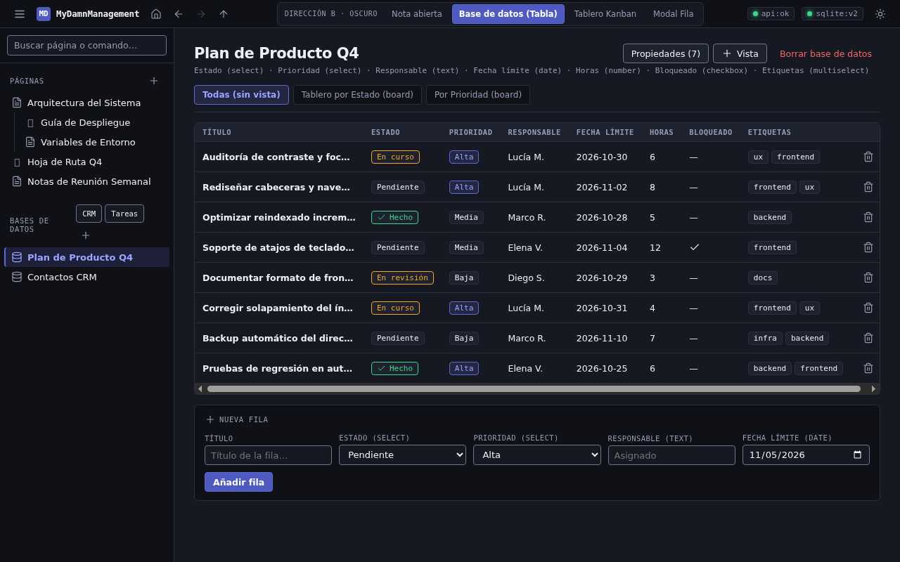
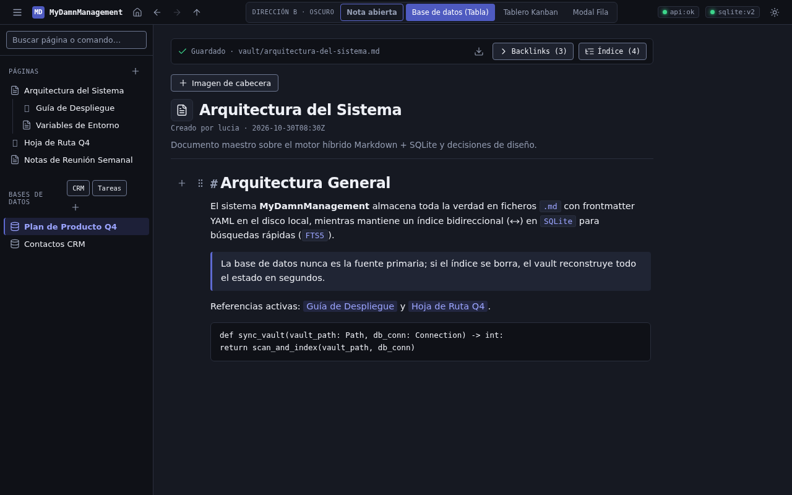
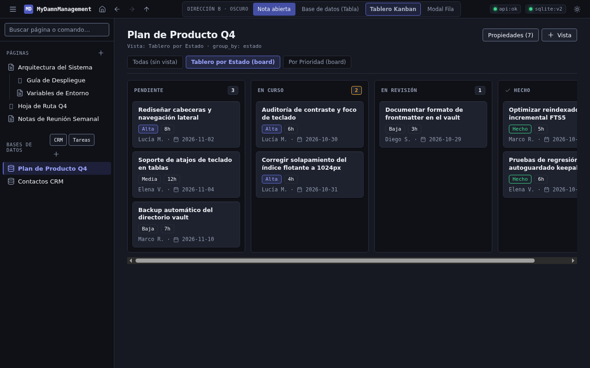
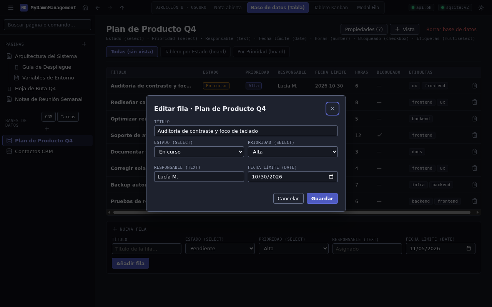
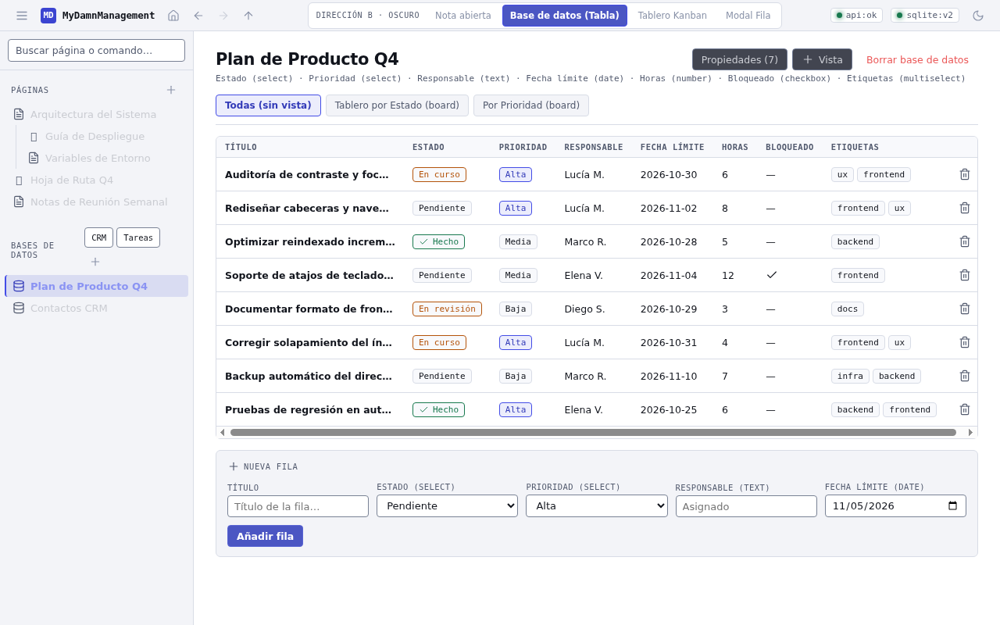

# Especificación de Aplicación — Dirección B: «Mesa de Operaciones» (`SPEC-B.md`)

Esta especificación define la aplicación completa de la **Dirección B («Mesa de Operaciones»)** en **tema oscuro por defecto**, con interruptor a tema claro persistente en `localStorage` y el nuevo set de iconos vectoriales SVG (`docs/diseno/iconos.svg`).

Está redactada para que el desarrollador la aplique directamente en `frontend/index.html` y `frontend/app.js` **sin interpretar ningún valor visual** y sin romper ninguno de los 116 tests ni los enganches de DOM existentes.

> **Fórmula de contraste y verificación reproducible (WCAG 2.1 / 2.2):**
> Cada cifra de contraste ($\text{CR}$) declarada en este documento se calcula a partir de los valores hexadecimales sRGB exactos mediante la luminancia relativa oficial:
> 1. Para cada canal $C \in \{R, G, B\} / 255$: si $C \le 0.04045$, $c = C / 12.92$; si $C > 0.04045$, $c = ((C + 0.055) / 1.055)^{2.4}$.
> 2. Luminancia relativa: $L = 0.2126 r + 0.7152 g + 0.0722 b$.
> 3. Ratio de contraste: $\text{CR} = (L_{\max} + 0.05) / (L_{\min} + 0.05)$, redondeado a 2 decimales.
> 4. Cuando un fondo tiene canal alfa ($\alpha$) sobre una superficie base $B$, el color compuesto efectivo se obtiene antes de medir la luminancia con $C_{\text{comp}} = \text{round}(\alpha \cdot C_{\text{fg}} + (1 - \alpha) \cdot C_B)$.

---

## 1. Tokens finales (`:root` oscuro por defecto + `html[data-theme="light"]`)

### 1.1. Regla de arranque del tema e interruptor `#btn-toggle-theme` (elemento nuevo a añadir en `frontend/index.html` y `frontend/app.js`)

> **Nota importante para el implementador:** Actualmente `frontend/index.html` solo tiene `@media (prefers-color-scheme: dark)` (línea 25) y **no existe todavía** el botón `#btn-toggle-theme` ni la lectura de `localStorage.getItem("mdm_theme")` en `frontend/app.js`. Para cumplir el requisito de tema oscuro por defecto con interruptor a claro funcional, el desarrollador debe añadir el marcado y el JS siguientes:

1. **Etiqueta raíz (`frontend/index.html:2`):** Cambiar `<html lang="es">` por `<html lang="es" data-theme="dark">`.
2. **Reemplazo de `@media (prefers-color-scheme: dark)` (`frontend/index.html:25-39`):** Eliminar el media query y pegar en su lugar el bloque `:root` (oscuro por defecto con `color-scheme: dark;`) y el bloque `html[data-theme="light"]` (con `color-scheme: light;`) de §1.2.
3. **Marcado del botón `#btn-toggle-theme` a insertar en `header` (`frontend/index.html:907-910`, dentro de `.status-strip`, justo después de `<span class="status-item"><span class="dot" id="dot-db"></span>db</span>`):**
   ```html
   <div class="status-strip">
     <span class="status-item"><span class="dot" id="dot-api"></span>api</span>
     <span class="status-item"><span class="dot" id="dot-db"></span>db</span>
     <button type="button" class="icon-btn" id="btn-toggle-theme" title="Cambiar a tema claro" aria-label="Cambiar entre tema oscuro y claro" aria-pressed="false">
       <svg class="svg-icon theme-icon-light" aria-hidden="true" focusable="false"><use href="#i-sun"/></svg>
       <svg class="svg-icon theme-icon-dark" aria-hidden="true" focusable="false"><use href="#i-moon"/></svg>
     </button>
   </div>
   ```
4. **Lógica JS de persistencia y conmutación a añadir en `frontend/app.js` (junto al bloque de `SIDEBAR_COLLAPSED_KEY` en `app.js:2526-2539`):**
   ```js
   const THEME_KEY = "mdm_theme";
   const themeBtn = document.getElementById("btn-toggle-theme");

   function applyTheme(theme) {
     const resolved = theme === "light" ? "light" : "dark";
     document.documentElement.dataset.theme = resolved;
     localStorage.setItem(THEME_KEY, resolved);
     if (themeBtn) {
       const isLight = resolved === "light";
       themeBtn.setAttribute("aria-pressed", isLight ? "true" : "false");
       themeBtn.title = isLight ? "Cambiar a tema oscuro" : "Cambiar a tema claro";
     }
   }

   themeBtn?.addEventListener("click", () => {
     const next = document.documentElement.dataset.theme === "light" ? "dark" : "light";
     applyTheme(next);
   });

   applyTheme(localStorage.getItem(THEME_KEY) || "dark");
   ```

### 1.2. Bloque CSS `:root` y `html[data-theme="light"]` listo para pegar

```css
  :root {
    color-scheme: dark;

    /* --- Superficies y bordes (Tema Oscuro por defecto) --- */
    --bg: #0f1117;               /* L = 0.0056 | Barra lateral, cabecera, carriles Kanban, barra nota */
    --panel: #161922;            /* L = 0.0098 | Lienzo principal (main), tabla de datos, inputs */
    --surface-elevated: #1e222e; /* L = 0.0162 | Tarjetas Kanban, diálogos <dialog>, menús flotantes, <th> */
    --panel-border: #2a2f3d;     /* L = 0.0286 | Divisores estructurales decorativos de 1px */
    --border-input: #6c7690;     /* L = 0.1816 | Bordes de controles interactivos (cumple >= 3:1 WCAG 1.4.11) */
    --code-bg: #202534;          /* L = 0.0188 | Bloques de código, citas y fondo :hover de filas/botones */

    /* --- Tipografía y tinta --- */
    --ink: #eef0f6;              /* L = 0.8715 | Texto primario (15.41:1 sobre --panel, 16.56:1 sobre --bg) */
    --ink-muted: #949db3;        /* L = 0.3366 | Texto secundario e iconos (6.46:1 sobre --panel, 6.95:1 sobre --bg) */

    /* --- Acento e interacción --- */
    --accent: #5e6ad2;           /* L = 0.1734 | Anillo :focus-visible y borde activo (3.74:1 sobre --panel, 4.02:1 sobre --bg) */
    --accent-btn: #4e5ac0;       /* L = 0.1274 | Fondo de botón primario .btn-primary */
    --accent-contrast: #ffffff;  /* L = 1.0000 | Texto sobre .btn-primary (5.92:1 sobre --accent-btn) */
    --accent-ink: #9ba4ff;       /* L = 0.4074 | Wikilinks, pestañas activas, fila activa (7.65:1 sobre --panel) */
    --accent-soft: rgba(94, 106, 210, 0.18); /* Compuesto: #1d2139 sobre --bg (L=0.0164), #232842 sobre --panel (L=0.0227) */

    /* --- Estados semánticos --- */
    --ok: #3dd68c;               /* L = 0.5098 | Online / completado (9.36:1 sobre --panel, 10.06:1 sobre --bg) */
    --warn: #f5a623;             /* L = 0.4681 | En curso / aviso (8.66:1 sobre --panel, 9.31:1 sobre --bg) */
    --down: #f26464;             /* L = 0.2891 | Peligro / error / vencido (5.67:1 sobre --panel, 6.09:1 sobre --bg) */
    --down-bg: rgba(242, 100, 100, 0.15);    /* Compuesto: #37242c sobre --panel (L=0.0226; --down da 4.67:1) */

    /* --- Tipografía (pilas del sistema, cero fuentes remotas) --- */
    --font-body: -apple-system, BlinkMacSystemFont, "Segoe UI", system-ui, "Helvetica Neue", Arial, sans-serif;
    --font-mono: "Cascadia Code", "Fira Code", ui-monospace, SFMono-Regular, Menlo, Consolas, monospace;

    /* --- Escala tipográfica --- */
    --text-xs: 10.5px;
    --text-sm: 11.5px;
    --text-base: 13px;
    --text-md: 13.5px;
    --text-prose: 14.5px;
    --text-lg: 16px;
    --text-db-title: 21px;
    --text-note-title: 24px;

    /* --- Radios --- */
    --radius-xs: 3px;
    --radius-sm: 4px;
    --radius-md: 6px;
    --radius-lg: 8px;

    /* --- Espaciado y dimensiones clave --- */
    --space-1: 4px;
    --space-2: 8px;
    --space-3: 12px;
    --space-4: 16px;
    --space-5: 22px;
    --space-6: 28px;
    --control-size: 28px;        /* Tamaño mínimo de botones de icono y asas de bloque (>= 24x24 WCAG 2.5.8) */
    --header-height: 40px;
    --sidebar-width: 248px;
    --sidebar-width-compact: 220px;
    --note-max-width: 780px;

    /* --- Sombras --- */
    --shadow-card: 0 1px 2px rgba(0, 0, 0, 0.35), inset 0 1px 0 rgba(255, 255, 255, 0.04);
    --shadow-float: 0 16px 40px rgba(0, 0, 0, 0.55), 0 0 0 1px rgba(255, 255, 255, 0.07);
    --shadow-toast: 0 8px 24px rgba(0, 0, 0, 0.45);

    /* --- Duraciones y curvas de movimiento --- */
    --dur-fast: 120ms;
    --dur-normal: 160ms;
    --dur-spin: 700ms;
    --ease-out: cubic-bezier(0.16, 1, 0.3, 1);
    --ease-std: ease;
  }

  html[data-theme="light"] {
    color-scheme: light;

    --bg: #f3f4f8;               /* L = 0.9053 */
    --panel: #ffffff;            /* L = 1.0000 */
    --surface-elevated: #f8f9fc; /* L = 0.9474 */
    --panel-border: #d8dce6;     /* L = 0.7150 */
    --border-input: #798295;     /* L = 0.2220 (3.86:1 sobre --panel, 3.67:1 sobre --surface-elevated, 3.51:1 sobre --bg) */
    --code-bg: #eaedf4;          /* L = 0.8459 */

    --ink: #11141c;              /* L = 0.0070 (18.41:1 sobre --panel, 16.75:1 sobre --bg) */
    --ink-muted: #525a6e;        /* L = 0.1023 (6.89:1 sobre --panel, 6.27:1 sobre --bg) */

    --accent: #434ce6;           /* L = 0.1208 (6.15:1 sobre --panel, 5.59:1 sobre --bg) */
    --accent-btn: #3b44d1;       /* L = 0.0967 */
    --accent-contrast: #ffffff;  /* L = 1.0000 (7.16:1 sobre --accent-btn) */
    --accent-ink: #323ab8;       /* L = 0.0716 (8.63:1 sobre --panel, 7.85:1 sobre --bg) */
    --accent-soft: rgba(67, 76, 230, 0.10); /* Compuesto: #e1e3f6 sobre --bg (L=0.7760), #ecedfc sobre --panel (L=0.8543) */

    --ok: #18794e;               /* L = 0.1442 (5.41:1 sobre --panel, 4.92:1 sobre --bg) */
    --warn: #b45309;             /* L = 0.1591 (5.02:1 sobre --panel, 4.57:1 sobre --bg) */
    --down: #c81e1e;             /* L = 0.1330 (5.74:1 sobre --panel, 5.22:1 sobre --bg) */
    --down-bg: rgba(200, 30, 30, 0.10);     /* Compuesto: #fae8e8 sobre --panel (L=0.8386; --down da 4.86:1) */

    --shadow-card: 0 1px 2px rgba(17, 20, 28, 0.06);
    --shadow-float: 0 12px 32px rgba(17, 20, 28, 0.16);
    --shadow-toast: 0 6px 18px rgba(17, 20, 28, 0.14);
  }

  /* Utilidad de accesibilidad para texto solo visible a lectores de pantalla */
  .sr-only {
    position: absolute;
    width: 1px;
    height: 1px;
    padding: 0;
    margin: -1px;
    overflow: hidden;
    clip: rect(0, 0, 0, 0);
    white-space: nowrap;
    border: 0;
  }

  /* Conmutación del icono en #btn-toggle-theme según el tema activo */
  html[data-theme="dark"] .theme-icon-dark { display: none; }
  html[data-theme="light"] .theme-icon-light { display: none; }
```

### 1.3. Tabla de verificación de contrastes (reproducible con la fórmula WCAG 2.x)

| Par evaluado (Primer plano vs. Fondo) | Hex Oscuro ($L_1$ vs. $L_2$) | Ratio Oscuro | Hex Claro ($L_1$ vs. $L_2$) | Ratio Claro | Umbral WCAG |
| :--- | :--- | :--- | :--- | :--- | :--- |
| `--ink` sobre `--panel` | `#eef0f6` ($0.8715$) vs. `#161922` ($0.0098$) | **15.41:1** | `#11141c` ($0.0070$) vs. `#ffffff` ($1.0000$) | **18.41:1** | $\ge 4.5:1$ (AAA) |
| `--ink` sobre `--bg` | `#eef0f6` ($0.8715$) vs. `#0f1117` ($0.0056$) | **16.56:1** | `#11141c` ($0.0070$) vs. `#f3f4f8` ($0.9053$) | **16.75:1** | $\ge 4.5:1$ (AAA) |
| `--ink` sobre `--surface-elevated` | `#eef0f6` ($0.8715$) vs. `#1e222e` ($0.0162$) | **13.93:1** | `#11141c` ($0.0070$) vs. `#f8f9fc` ($0.9474$) | **17.49:1** | $\ge 4.5:1$ (AAA) |
| `--ink-muted` sobre `--panel` | `#949db3` ($0.3366$) vs. `#161922` ($0.0098$) | **6.46:1** | `#525a6e` ($0.1023$) vs. `#ffffff` ($1.0000$) | **6.89:1** | $\ge 4.5:1$ (AA) |
| `--ink-muted` sobre `--bg` | `#949db3` ($0.3366$) vs. `#0f1117` ($0.0056$) | **6.95:1** | `#525a6e` ($0.1023$) vs. `#f3f4f8` ($0.9053$) | **6.27:1** | $\ge 4.5:1$ (AA) |
| `--ink-muted` sobre `--surface-elevated` | `#949db3` ($0.3366$) vs. `#1e222e` ($0.0162$) | **5.84:1** | `#525a6e` ($0.1023$) vs. `#f8f9fc` ($0.9474$) | **6.55:1** | $\ge 4.5:1$ (AA) |
| `--ink-muted` sobre `--code-bg` | `#949db3` ($0.3366$) vs. `#202534` ($0.0188$) | **5.62:1** | `#525a6e` ($0.1023$) vs. `#eaedf4` ($0.8459$) | **5.88:1** | $\ge 4.5:1$ (AA) |
| `.btn-primary`: `--accent-contrast` sobre `--accent-btn` | `#ffffff` ($1.0000$) vs. `#4e5ac0` ($0.1274$) | **5.92:1** | `#ffffff` ($1.0000$) vs. `#3b44d1` ($0.0967$) | **7.16:1** | $\ge 4.5:1$ (AA/AAA) |
| `--accent-ink` sobre `--panel` | `#9ba4ff` ($0.4074$) vs. `#161922` ($0.0098$) | **7.65:1** | `#323ab8` ($0.0716$) vs. `#ffffff` ($1.0000$) | **8.63:1** | $\ge 4.5:1$ (AAA) |
| `--accent-ink` sobre `--bg` | `#9ba4ff` ($0.4074$) vs. `#0f1117` ($0.0056$) | **8.22:1** | `#323ab8` ($0.0716$) vs. `#f3f4f8` ($0.9053$) | **7.85:1** | $\ge 4.5:1$ (AAA) |
| `--accent-ink` sobre `--accent-soft` (en `--bg`) | `#9ba4ff` ($0.4074$) vs. `#1d2139` ($0.0164$) | **6.88:1** | `#323ab8` ($0.0716$) vs. `#e1e3f6` ($0.7760$) | **6.79:1** | $\ge 4.5:1$ (AA) |
| `--accent-ink` sobre `--accent-soft` (en `--panel`) | `#9ba4ff` ($0.4074$) vs. `#232842` ($0.0227$) | **6.29:1** | `#323ab8` ($0.0716$) vs. `#ecedfc` ($0.8543$) | **7.43:1** | $\ge 4.5:1$ (AAA) |
| `--border-input` sobre `--panel` | `#6c7690` ($0.1816$) vs. `#161922` ($0.0098$) | **3.87:1** | `#798295` ($0.2220$) vs. `#ffffff` ($1.0000$) | **3.86:1** | $\ge 3.0:1$ (1.4.11) |
| `--border-input` sobre `--bg` | `#6c7690` ($0.1816$) vs. `#0f1117` ($0.0056$) | **4.16:1** | `#798295` ($0.2220$) vs. `#f3f4f8` ($0.9053$) | **3.51:1** | $\ge 3.0:1$ (1.4.11) |
| `--border-input` sobre `--surface-elevated` | `#6c7690` ($0.1816$) vs. `#1e222e` ($0.0162$) | **3.50:1** | `#798295` ($0.2220$) vs. `#f8f9fc` ($0.9474$) | **3.67:1** | $\ge 3.0:1$ (1.4.11) |
| Foco `--accent` sobre `--panel` | `#5e6ad2` ($0.1734$) vs. `#161922` ($0.0098$) | **3.74:1** | `#434ce6` ($0.1208$) vs. `#ffffff` ($1.0000$) | **6.15:1** | $\ge 3.0:1$ (2.4.11) |
| Foco `--accent` sobre `--bg` | `#5e6ad2` ($0.1734$) vs. `#0f1117` ($0.0056$) | **4.02:1** | `#434ce6` ($0.1208$) vs. `#f3f4f8` ($0.9053$) | **5.59:1** | $\ge 3.0:1$ (2.4.11) |
| Foco `--accent` sobre `--surface-elevated` | `#5e6ad2` ($0.1734$) vs. `#1e222e` ($0.0162$) | **3.38:1** | `#434ce6` ($0.1208$) vs. `#f8f9fc` ($0.9474$) | **5.84:1** | $\ge 3.0:1$ (2.4.11) |
| `--ok` sobre `--panel` | `#3dd68c` ($0.5098$) vs. `#161922` ($0.0098$) | **9.36:1** | `#18794e` ($0.1442$) vs. `#ffffff` ($1.0000$) | **5.41:1** | $\ge 4.5:1$ (AA) |
| `--warn` sobre `--panel` | `#f5a623` ($0.4681$) vs. `#161922` ($0.0098$) | **8.66:1** | `#b45309` ($0.1591$) vs. `#ffffff` ($1.0000$) | **5.02:1** | $\ge 4.5:1$ (AA) |
| `--down` sobre `--panel` | `#f26464` ($0.2891$) vs. `#161922` ($0.0098$) | **5.67:1** | `#c81e1e` ($0.1330$) vs. `#ffffff` ($1.0000$) | **5.74:1** | $\ge 4.5:1$ (AA) |
| `--down` sobre `--bg` | `#f26464` ($0.2891$) vs. `#0f1117` ($0.0056$) | **6.09:1** | `#c81e1e` ($0.1330$) vs. `#f3f4f8` ($0.9053$) | **5.22:1** | $\ge 4.5:1$ (AA) |
| `--down` sobre `--down-bg` (en `--panel`) | `#f26464` ($0.2891$) vs. `#37242c` ($0.0226$) | **4.67:1** | `#c81e1e` ($0.1330$) vs. `#fae8e8` ($0.8386$) | **4.86:1** | $\ge 4.5:1$ (AA) |

---

## 2. Mapa de aplicación completo (Selector real → Propiedad → Valor)

Todos los selectores listados a continuación son los que existen en `frontend/index.html` y `frontend/app.js`, más las clases nuevas creadas explícitamente en esta spec: `.svg-icon` (`.icon-18`, `.icon-20`), `.sr-only`, `#btn-toggle-theme` (`.theme-icon-light`, `.theme-icon-dark`) e `.is-dragover` / `.is-dragging` para el arrastre en `.board-col`.

### 2.1. Base, Cabecera (`header`) y Layout (`aside`, `main`)

| Selector en `frontend/index.html` | Propiedad → Valor exacto |
| :--- | :--- |
| `body` | `background: var(--panel); color: var(--ink); font-family: var(--font-body); font-size: var(--text-base); display: flex; flex-direction: column; -webkit-font-smoothing: antialiased;` |
| `input, select, textarea, button` | `font-family: inherit; font-size: var(--text-base); color: var(--ink);` |
| `:focus-visible` | `outline: 2px solid var(--accent); outline-offset: 2px;` |
| `.svg-icon` | `display: inline-block; width: 16px; height: 16px; stroke: currentColor; fill: none; stroke-width: 1.75; stroke-linecap: round; stroke-linejoin: round; flex-shrink: 0; vertical-align: middle;` |
| `.svg-icon.icon-18` | `width: 18px; height: 18px;` |
| `.svg-icon.icon-20` | `width: 20px; height: 20px;` |
| `.sr-only` *(nueva)* | `position: absolute; width: 1px; height: 1px; padding: 0; margin: -1px; overflow: hidden; clip: rect(0, 0, 0, 0); white-space: nowrap; border: 0;` |
| `html[data-theme="dark"] .theme-icon-dark, html[data-theme="light"] .theme-icon-light` *(nueva)* | `display: none;` |
| `header` | `flex-shrink: 0; height: var(--header-height); display: flex; align-items: center; justify-content: space-between; padding: 0 14px; border-bottom: 1px solid var(--panel-border); background: var(--bg);` |
| `.header-left` | `display: flex; align-items: center; gap: 10px;` |
| `header .brand` | `display: flex; align-items: center; gap: 8px; font-family: var(--font-mono); font-size: 12.5px; font-weight: 600; letter-spacing: -0.01em; color: var(--ink);` |
| `.brand-logo` | `width: 20px; height: 20px; border-radius: var(--radius-sm); display: block;` |
| `.nav-history-controls` | `display: flex; gap: 4px;` *(sube de `2px` a `4px` para evitar clics erróneos)* |
| `.status-strip` | `display: flex; align-items: center; gap: 10px; font-family: var(--font-mono); font-size: 11px; color: var(--ink-muted);` |
| `.status-item` | `display: flex; align-items: center; gap: 5px; background: var(--panel); border: 1px solid var(--panel-border); padding: 2px 7px; border-radius: var(--radius-sm);` |
| `.dot` | `width: 7px; height: 7px; border-radius: 50%; background: var(--ink-muted);` |
| `.dot.ok` | `background: var(--ok); box-shadow: 0 0 6px var(--ok);` |
| `.dot.down` | `background: var(--down);` |
| `.layout` | `flex: 1; display: flex; min-height: 0;` |
| `aside` | `width: var(--sidebar-width); flex-shrink: 0; border-right: 1px solid var(--panel-border); background: var(--bg); display: flex; flex-direction: column; overflow-y: auto;` |
| `@media (max-width: 1100px) { aside }` | `width: var(--sidebar-width-compact);` *(libera `60px` horizontales a 1024 px respecto a los `280px` actuales)* |
| `.layout.sidebar-collapsed aside` | `display: none;` |
| `main` | `flex: 1; min-width: 0; overflow-y: auto; background: var(--panel); padding: 22px 28px 56px;` |
| `@media (max-width: 1100px) { main }` | `padding: 18px 20px 48px;` |

### 2.2. Barra lateral (`aside`), Búsqueda y Árbol de páginas/bases

| Selector | Propiedad → Valor exacto |
| :--- | :--- |
| `.sidebar-search` | `padding: 10px; border-bottom: 1px solid var(--panel-border);` |
| `.sidebar-search input` | `width: 100%; padding: 6px 9px; min-height: var(--control-size); border-radius: var(--radius-sm); border: 1px solid var(--border-input); background: var(--panel); color: var(--ink); font-size: 12.5px;` |
| `.sidebar-search input::placeholder` | `color: var(--ink-muted);` |
| `.sidebar-section` | `padding: 8px 6px;` |
| `.sidebar-section-head` | `display: flex; align-items: center; justify-content: space-between; padding: 3px 8px; font-family: var(--font-mono); font-size: var(--text-xs); letter-spacing: 0.06em; text-transform: uppercase; color: var(--ink-muted);` |
| `.icon-btn` | `background: none; border: 1px solid transparent; border-radius: var(--radius-sm); color: var(--ink-muted); width: var(--control-size); height: var(--control-size); min-width: 28px; min-height: 28px; padding: 0; line-height: 1; font-size: 13.5px; display: inline-flex; align-items: center; justify-content: center; transition: background-color var(--dur-fast) var(--ease-std), color var(--dur-fast) var(--ease-std), border-color var(--dur-fast) var(--ease-std);` |
| `.icon-btn:hover` | `background: var(--code-bg); color: var(--ink); border-color: var(--panel-border);` |
| `.icon-btn:disabled` | `opacity: 0.35; cursor: default; pointer-events: none;` |
| `.template-btn` | `background: var(--panel); border: 1px solid var(--border-input); border-radius: var(--radius-sm); color: var(--ink); font-family: var(--font-mono); font-size: var(--text-xs); padding: 2px 8px; min-height: 26px; display: inline-flex; align-items: center;` |
| `.template-btn:hover` | `border-color: var(--accent); color: var(--accent-ink); background: var(--code-bg);` |
| `.tree-node` | `user-select: none;` |
| `.tree-row` | `display: flex; align-items: center; gap: 7px; padding: 5px 8px; min-height: 28px; border-radius: var(--radius-sm); cursor: pointer; font-size: var(--text-base); color: var(--ink); white-space: nowrap; overflow: hidden; text-overflow: ellipsis; border-left: 2px solid transparent; transition: background-color var(--dur-fast) var(--ease-std), color var(--dur-fast) var(--ease-std);` |
| `.tree-row:hover` | `background: var(--code-bg);` |
| `.tree-row.active` | `background: var(--accent-soft); color: var(--accent-ink); border-left-color: var(--accent); font-weight: 600;` |
| `.tree-row-selected` | `outline: 1.5px solid var(--accent); outline-offset: -1.5px; background: var(--code-bg);` |
| `.tree-row .type-icon` | `flex-shrink: 0; width: 16px; height: 16px; display: inline-flex; align-items: center; justify-content: center; font-size: 13px; color: var(--ink-muted);` |
| `.tree-row.active .type-icon` | `color: var(--accent-ink);` |
| `.tree-children` | `margin-left: 14px; border-left: 1px solid var(--panel-border); padding-left: 4px;` |
| `.search-results` | `padding: 6px;` |
| `.search-hit` | `display: flex; align-items: center; gap: 7px; padding: 6px 8px; min-height: 28px; border-radius: var(--radius-sm); cursor: pointer; font-size: var(--text-base); color: var(--ink);` |
| `.search-hit:hover` | `background: var(--code-bg); color: var(--accent-ink);` |
| `.search-empty` | `padding: 8px; font-size: 12.5px; color: var(--ink-muted);` |

### 2.3. Botones generales (`.btn`, `.btn-primary`, `.btn-danger`) y Dashboard (`.dashboard`)

| Selector | Propiedad → Valor exacto |
| :--- | :--- |
| `.btn` | `font-size: 12.5px; padding: 5px 11px; min-height: var(--control-size); border-radius: var(--radius-sm); border: 1px solid var(--border-input); background: var(--surface-elevated); color: var(--ink); font-weight: 500; display: inline-flex; align-items: center; justify-content: center; gap: 6px; transition: background-color var(--dur-fast) var(--ease-std), border-color var(--dur-fast) var(--ease-std), color var(--dur-fast) var(--ease-std);` |
| `.btn:hover` | `border-color: var(--accent); color: var(--accent-ink); background: var(--code-bg);` |
| `.btn-primary` | `background: var(--accent-btn); border-color: var(--accent); color: var(--accent-contrast); font-weight: 600;` |
| `.btn-primary:hover` | `filter: brightness(1.1); background: var(--accent-btn); border-color: var(--accent); color: var(--accent-contrast);` |
| `.btn-danger` | `color: var(--down); border-color: transparent; background: none;` |
| `.btn-danger:hover` | `background: var(--down-bg); border-color: var(--down); color: var(--down);` |
| `.btn-row` | `display: flex; gap: 6px; flex-wrap: wrap; align-items: center;` |
| `.empty-state` | `height: 100%; display: flex; align-items: center; justify-content: center; color: var(--ink-muted); font-size: 13.5px; text-align: center;` |
| `.dashboard` | `max-width: 680px; display: flex; flex-direction: column; gap: 24px;` |
| `.dashboard-section-head` | `font-family: var(--font-mono); font-size: var(--text-xs); letter-spacing: 0.06em; text-transform: uppercase; color: var(--ink-muted); margin-bottom: 8px;` |
| `.dashboard-item` | `display: flex; align-items: center; gap: 10px; padding: 8px 10px; min-height: 34px; border-radius: var(--radius-md); border: 1px solid transparent; cursor: pointer; transition: background-color var(--dur-fast) var(--ease-std), border-color var(--dur-fast) var(--ease-std);` |
| `.dashboard-item:hover` | `background: var(--code-bg); border-color: var(--panel-border);` |
| `.dashboard-item-icon` | `width: 18px; height: 18px; display: inline-flex; align-items: center; justify-content: center; font-size: 15px; flex-shrink: 0; color: var(--ink-muted);` |
| `.dashboard-item-title` | `flex: 1; min-width: 0; overflow: hidden; text-overflow: ellipsis; white-space: nowrap; font-weight: 500;` |
| `.dashboard-item-sub` | `color: var(--ink-muted); font-size: 12px; font-weight: 400;` |
| `.dashboard-item-meta` | `flex-shrink: 0; font-size: var(--text-sm); color: var(--ink-muted); font-family: var(--font-mono); font-variant-numeric: tabular-nums;` |
| `.dashboard-item-meta.overdue` | `color: var(--down); font-weight: 600;` |

### 2.4. Vista de Nota (`.note-topbar`, `.note-outline-dropdown`, `.note-title`, `#note-body`)

| Selector | Propiedad → Valor exacto |
| :--- | :--- |
| `.note-topbar, .note-header-image-wrap, .note-title-row, .note-meta, .note-description, #note-body` | `max-width: var(--note-max-width);` *(acota el ancho de lectura a `780px` sin necesidad de cambiar la jerarquía DOM de `renderNote`)* |
| `.note-topbar` | `display: flex; align-items: center; justify-content: space-between; margin-bottom: 16px; padding: 6px 10px; min-height: 36px; background: var(--bg); border: 1px solid var(--panel-border); border-radius: var(--radius-md);` |
| `.note-savestatus` | `display: flex; align-items: center; gap: 6px; font-family: var(--font-mono); font-size: var(--text-sm); color: var(--ink-muted); font-variant-numeric: tabular-nums;` |
| `.note-savestatus.is-error` | `color: var(--down); font-weight: 600;` |
| `.note-savestatus-icon` | `display: inline-flex; width: 16px; height: 16px; align-items: center; justify-content: center; color: var(--ok);` |
| `.note-savestatus.is-error .note-savestatus-icon` | `color: var(--down);` |
| `.spinner` | `width: 12px; height: 12px; border: 1.75px solid var(--panel-border); border-top-color: var(--accent); border-radius: 50%; animation: mdm-spin var(--dur-spin) linear infinite;` |
| `.note-topbar-right` | `display: flex; align-items: center; gap: 8px;` |
| `.note-backlinks-dropdown, .note-outline-dropdown` | `position: relative; font-size: 12px; color: var(--ink);` *(se elimina `position: fixed; top: 60px; right: 20px` de `.note-outline-dropdown`; ahora vive dentro de `.note-topbar-right`)* |
| `.note-backlinks-dropdown summary, .note-outline-dropdown summary` | `cursor: pointer; list-style: none; font-family: var(--font-mono); font-size: var(--text-sm); color: var(--ink); background: var(--surface-elevated); border: 1px solid var(--border-input); padding: 4px 9px; min-height: var(--control-size); border-radius: var(--radius-sm); display: inline-flex; align-items: center; gap: 5px; user-select: none;` |
| `.note-backlinks-dropdown summary:hover, .note-outline-dropdown summary:hover` | `border-color: var(--accent); color: var(--accent-ink); background: var(--code-bg);` |
| `.note-backlinks-dropdown summary::-webkit-details-marker, .note-outline-dropdown summary::-webkit-details-marker` | `display: none;` |
| `.note-backlinks-dropdown summary::before, .note-outline-dropdown summary::before` | `content: none;` *(los iconos `▸/▾` y `📑` pasan a ser `<svg class="svg-icon">` reales dentro del `<summary>`)* |
| `.note-backlinks-dropdown .backlinks-list, .note-outline-dropdown .note-outline-list` | `position: absolute; top: calc(100% + 5px); right: 0; z-index: 900; width: 240px; max-height: 60vh; overflow-y: auto; background: var(--surface-elevated); border: 1px solid var(--border-input); border-radius: var(--radius-md); box-shadow: var(--shadow-float); padding: 6px; margin-top: 0; display: flex; flex-direction: column; gap: 2px;` |
| `.note-outline-item, .backlink-item` | `display: flex; align-items: center; gap: 6px; width: 100%; text-align: left; padding: 5px 8px; min-height: 28px; border-radius: var(--radius-sm); border: none; background: none; color: var(--ink); font-size: 12.5px; cursor: pointer; white-space: nowrap; overflow: hidden; text-overflow: ellipsis;` |
| `.note-outline-item:hover, .backlink-item:hover` | `background: var(--code-bg); color: var(--accent-ink);` |
| `.note-header-image-wrap` | `margin-bottom: 12px;` |
| `.note-header-image` | `display: block; width: 100%; max-height: 220px; object-fit: cover; border-radius: var(--radius-md); margin-bottom: 6px; border: 1px solid var(--panel-border);` |
| `.note-header-remove` | `background: var(--surface-elevated); border: 1px solid var(--border-input); border-radius: var(--radius-sm); color: var(--ink-muted); font-size: 12px; cursor: pointer; padding: 4px 10px; min-height: var(--control-size); display: inline-flex; align-items: center; gap: 5px;` *(sube de `15px` sin padding a `min-height: 28px`)* |
| `.note-header-remove:hover` | `color: var(--down); border-color: var(--down); background: var(--down-bg);` |
| `.note-title-row` | `display: flex; align-items: center; gap: 10px; margin-bottom: 4px;` |
| `.note-icon-btn` | `font-size: 20px; width: 36px; height: 36px; flex-shrink: 0; border: 1px solid var(--panel-border); background: var(--surface-elevated); padding: 0; display: inline-flex; align-items: center; justify-content: center; border-radius: var(--radius-md); cursor: pointer; line-height: 1; color: var(--ink);` |
| `.note-icon-btn:hover, .note-icon-btn:focus-visible` | `background: var(--code-bg); border-color: var(--accent);` |
| `.note-title` | `font-family: var(--font-body); font-size: var(--text-note-title); font-weight: 700; letter-spacing: -0.02em; border: none; background: none; color: var(--ink); width: 100%; padding: 2px 0; margin-bottom: 2px;` |
| `.note-meta` | `font-family: var(--font-mono); font-size: var(--text-sm); color: var(--ink-muted); margin-bottom: 10px; font-variant-numeric: tabular-nums;` |
| `.note-description` | `width: 100%; border: none; border-bottom: 1px solid var(--panel-border); background: none; color: var(--ink-muted); font-family: var(--font-body); font-size: var(--text-md); line-height: 1.5; padding: 0 0 12px; margin-bottom: 18px; resize: none; overflow: hidden;` |
| `.note-description:focus` | `color: var(--ink); border-bottom-color: var(--accent);` |
| `#note-body .cm-content` | `padding: 4px 4px 220px 64px; font-family: var(--font-body); font-size: var(--text-prose); line-height: 1.62; color: var(--ink); caret-color: var(--ink);` *(`padding-left: 64px` aloja holgadamente las dos asas de `28x28px` + `2px` de gap = `58px`)* |
| `.cm-mdm-mark, .cm-mdm-wikimark` | `color: var(--ink-muted); opacity: 1; font-family: var(--font-mono); font-size: 0.82em;` *(se elimina `opacity: 0.55` para garantizar **6.46:1** en oscuro y **6.89:1** en claro)* |
| `.cm-mdm-h1` | `font-size: 1.65em; font-weight: 700; line-height: 1.25; letter-spacing: -0.02em;` |
| `.cm-mdm-h2` | `font-size: 1.35em; font-weight: 600; line-height: 1.3; letter-spacing: -0.01em;` |
| `.cm-mdm-h3` | `font-size: 1.15em; font-weight: 600; line-height: 1.3;` |
| `.cm-mdm-code` | `font-family: var(--font-mono); font-size: 0.88em; background: var(--code-bg); border: 1px solid var(--panel-border); border-radius: var(--radius-xs); padding: 1px 5px; color: var(--accent-ink);` |
| `.cm-mdm-wikilink-rendered, .cm-mdm-mdlink-rendered` | `color: var(--accent-ink); background: var(--accent-soft); padding: 1px 5px; border-radius: var(--radius-xs); text-decoration: none; cursor: pointer;` |
| `.cm-mdm-wikilink-rendered:hover, .cm-mdm-mdlink-rendered:hover` | `text-decoration: underline; text-decoration-color: var(--accent-ink);` |
| `#note-body .cm-mdm-line-code` | `background: var(--bg); font-family: var(--font-mono); font-size: 12.5px; padding: 2px 10px;` |
| `#note-body .cm-mdm-line-quote` | `background: var(--code-bg); padding: 4px 12px;` |
| `.cm-mdm-block-handle-wrap` | `position: absolute; left: -60px; top: 0; display: flex; align-items: center; gap: 2px; opacity: 0; transition: opacity var(--dur-fast) var(--ease-std);` |
| `#note-body .cm-line:hover .cm-mdm-block-handle-wrap, #note-body .cm-line:focus-within .cm-mdm-block-handle-wrap, .cm-mdm-block-handle-wrap:focus-within, .cm-mdm-block-handle-wrap:has(.cm-mdm-block-handle-selected)` | `opacity: 1;` *(al recibir foco por teclado `:focus-within`, el contenedor pasa a `opacity: 1` íntegro, de modo que el anillo `:focus-visible` de `2px solid var(--accent)` se pinta al 100 % con ratio **3.74:1** en oscuro y **6.15:1** en claro)* |
| `.cm-mdm-block-add, .cm-mdm-block-handle` | `width: 28px; height: 28px; min-width: 28px; min-height: 28px; padding: 0; border: 1px solid transparent; border-radius: var(--radius-sm); background: none; color: var(--ink-muted); opacity: 1; display: inline-flex; align-items: center; justify-content: center; cursor: pointer; user-select: none;` *(sube de `18x24px` / `18x22px` a `28x28px` y elimina `opacity: 0.55`)* |
| `.cm-mdm-block-add:hover, .cm-mdm-block-handle:hover` | `background: var(--code-bg); color: var(--ink); border-color: var(--panel-border);` |
| `.cm-mdm-block-handle-selected` | `background: var(--accent-soft); color: var(--accent-ink); border-color: var(--accent);` |

### 2.5. Menús flotantes (`.mdm-context-menu`, `.mdm-emoji-picker`, `.mdm-slash-menu`, `.mdm-link-preview`, `.error-toast`)

| Selector | Propiedad → Valor exacto |
| :--- | :--- |
| `.mdm-context-menu, .mdm-slash-menu, .mdm-emoji-picker, .mdm-link-preview` | `background: var(--surface-elevated); border: 1px solid var(--border-input); border-radius: var(--radius-lg); box-shadow: var(--shadow-float);` |
| `.mdm-context-menu-item, .mdm-slash-menu-item` | `padding: 6px 10px; min-height: 28px; border-radius: var(--radius-sm); font-size: var(--text-base); color: var(--ink);` |
| `.mdm-context-menu-item:hover` | `background: var(--code-bg);` |
| `.mdm-context-menu-item.danger` | `color: var(--down);` |
| `.mdm-context-menu-item.danger:hover` | `background: var(--down-bg);` |
| `.mdm-emoji-search` | `width: 100%; padding: 6px 9px; min-height: 28px; margin-bottom: 8px; border-radius: var(--radius-sm); border: 1px solid var(--border-input); background: var(--panel); color: var(--ink);` |
| `.mdm-emoji-option` | `font-size: 18px; min-height: 32px; padding: 4px 0; border-radius: var(--radius-sm);` |
| `.error-toast` | `pointer-events: auto; display: flex; align-items: center; gap: 8px; padding: 8px 10px 8px 12px; border: 1px solid var(--border-input); border-left: 3px solid var(--down); border-radius: var(--radius-md); background: var(--surface-elevated); color: var(--ink); font-size: 12.5px; box-shadow: var(--shadow-toast); animation: mdm-toast-in var(--dur-normal) var(--ease-out);` |
| `.error-toast-close` | `flex: 0 0 auto; width: 28px; height: 28px; min-width: 28px; min-height: 28px; padding: 0; border: 1px solid transparent; border-radius: var(--radius-sm); background: none; color: var(--ink-muted); display: inline-flex; align-items: center; justify-content: center;` *(sube de `13x15px` a `28x28px`)* |
| `.error-toast-close:hover` | `color: var(--down); background: var(--down-bg); border-color: var(--down);` |

### 2.6. Vistas de Base de Datos (`.rows-table`, `.board`, `.inline-form`, `<dialog>`)

| Selector | Propiedad → Valor exacto |
| :--- | :--- |
| `.db-header` | `display: flex; align-items: center; justify-content: space-between; flex-wrap: wrap; gap: 10px; margin-bottom: 4px;` |
| `.db-title` | `font-family: var(--font-body); font-size: var(--text-db-title); font-weight: 700; letter-spacing: -0.02em; border: none; background: none; color: var(--ink); padding: 2px 0; min-width: 160px;` |
| `.db-schema-hint` | `font-family: var(--font-mono); font-size: 11px; color: var(--ink-muted); margin-bottom: 14px;` |
| `.view-tabs` | `display: flex; gap: 6px; margin-bottom: 14px; flex-wrap: wrap; border-bottom: 1px solid var(--panel-border); padding-bottom: 10px;` |
| `.view-tab` | `font-size: 12px; padding: 5px 11px; min-height: var(--control-size); border-radius: var(--radius-sm); border: 1px solid var(--panel-border); background: var(--bg); color: var(--ink-muted); font-weight: 500;` |
| `.view-tab:hover` | `color: var(--ink); border-color: var(--border-input);` |
| `.view-tab.active` | `border-color: var(--accent); color: var(--accent-ink); background: var(--accent-soft); font-weight: 600;` |
| `.table-wrap` | `overflow-x: auto; border: 1px solid var(--panel-border); border-radius: var(--radius-md); background: var(--panel);` |
| `table.rows-table` | `width: 100%; border-collapse: collapse; font-size: 12.5px;` |
| `.rows-table th, .rows-table td` | `text-align: left; padding: 7px 11px; border-bottom: 1px solid var(--panel-border); font-variant-numeric: tabular-nums; max-width: 240px; overflow: hidden; text-overflow: ellipsis; white-space: nowrap;` |
| `.rows-table th` | `background: var(--surface-elevated); font-family: var(--font-mono); font-size: var(--text-xs); text-transform: uppercase; letter-spacing: 0.05em; color: var(--ink-muted); font-weight: 600;` |
| `.rows-table td:first-child` | `font-weight: 600; color: var(--ink);` |
| `.rows-table tr:hover td` | `background: var(--code-bg);` |
| `.rows-table td:focus-visible` | `outline: 2px solid var(--accent); outline-offset: -2px; background: var(--accent-soft);` |
| `.row-del, .cell-del` | `color: var(--ink-muted); background: none; border: 1px solid transparent; border-radius: var(--radius-sm); cursor: pointer; width: var(--control-size); height: var(--control-size); min-width: 28px; min-height: 28px; padding: 0; display: inline-flex; align-items: center; justify-content: center;` *(sube de `19.8x17px` a `28x28px`)* |
| `.row-del:hover, .cell-del:hover` | `color: var(--down); background: var(--down-bg); border-color: var(--down);` |
| `.board` | `display: flex; gap: 12px; overflow-x: auto; padding-bottom: 10px;` |
| `.board-col` | `flex: 0 0 256px; background: var(--bg); border: 1px solid var(--panel-border); border-radius: var(--radius-md); padding: 10px; display: flex; flex-direction: column; gap: 8px; transition: border-color var(--dur-fast) var(--ease-std), background-color var(--dur-fast) var(--ease-std);` |
| `.board-col.is-dragover` | `border-color: var(--accent); background: var(--accent-soft); outline: 1px dashed var(--accent); outline-offset: -3px;` |
| `.board-col-head` | `font-family: var(--font-mono); font-size: 11px; font-weight: 600; color: var(--ink-muted); padding: 2px 4px 6px; display: flex; justify-content: space-between; align-items: center; text-transform: uppercase; letter-spacing: 0.04em;` |
| `.board-card` | `background: var(--surface-elevated); border: 1px solid var(--panel-border); border-radius: var(--radius-md); padding: 10px 12px; font-size: 12.5px; cursor: pointer; box-shadow: var(--shadow-card); transition: border-color var(--dur-fast) var(--ease-std), transform var(--dur-fast) var(--ease-std);` |
| `.board-card:hover` | `border-color: var(--accent);` |
| `.board-card-title` | `font-weight: 600; margin-bottom: 6px; color: var(--ink); line-height: 1.35;` |
| `.board-card-prop` | `color: var(--ink-muted); font-size: var(--text-sm); font-family: var(--font-mono);` |
| `.inline-form` | `margin-top: 14px; padding: 12px 14px; border: 1px solid var(--panel-border); border-radius: var(--radius-md); background: var(--bg); display: grid; grid-template-columns: repeat(auto-fill, minmax(150px, 1fr)); gap: 10px; align-items: end;` *(convierte el contenedor `.inline-form` directamente en rejilla CSS sin romper `renderAddRowForm`)* |
| `.inline-form > .panel-head` | `grid-column: 1 / -1; margin: 0 0 2px !important; font-family: var(--font-mono); font-size: var(--text-xs); letter-spacing: 0.06em; text-transform: uppercase; color: var(--ink-muted);` |
| `.inline-form > .field` | `margin-bottom: 0;` |
| `.inline-form > .btn-primary` | `height: var(--control-size); align-self: end; justify-self: start;` |
| `.field` | `display: flex; flex-direction: column; gap: 4px; margin-bottom: 10px;` |
| `.field label` | `font-family: var(--font-mono); font-size: var(--text-xs); color: var(--ink-muted); text-transform: uppercase; letter-spacing: 0.04em;` |
| `.field input, .field select, .field textarea` | `padding: 5px 8px; min-height: var(--control-size); border-radius: var(--radius-sm); border: 1px solid var(--border-input); background: var(--panel); color: var(--ink);` |
| `dialog` | `border: 1px solid var(--border-input); border-radius: var(--radius-lg); padding: 20px; background: var(--surface-elevated); color: var(--ink); width: min(520px, 92vw); box-shadow: var(--shadow-float);` *(sube de `440px` a `520px` para que `.prop-row` no trunque inputs)* |
| `dialog::backdrop` | `background: rgba(0, 0, 0, 0.65);` |
| `dialog h3` | `font-family: var(--font-body); font-weight: 700; margin: 0 0 14px; font-size: var(--text-lg);` |
| `#prop-rows, #row-props` | `max-height: 55vh; overflow-y: auto; padding-right: 2px;` |
| `.prop-row` | `display: grid; grid-template-columns: 1fr 1fr 110px 28px; gap: 6px; align-items: center;` |
| `.prop-row input, .prop-row select, .prop-options-input` | `padding: 5px 8px; min-height: var(--control-size); border-radius: var(--radius-sm); border: 1px solid var(--border-input); background: var(--panel); color: var(--ink); font-size: 12.5px;` |
| `.dialog-actions` | `display: flex; justify-content: flex-end; gap: 8px; margin-top: 16px;` |

---

## 3. Los siete estados interactivos (con valores exactos)

Ningún componente queda a la invención del desarrollador:

1. **Hover (`:hover`):**
   - Filas y opciones (`.tree-row`, `.dashboard-item`, `.search-hit`, `.note-outline-item`, `.backlink-item`, `.mdm-context-menu-item`, `.rows-table tr:hover td`): `background: var(--code-bg)` (`#202534` en oscuro / `#eaedf4` en claro).
   - Botones secundarios (`.btn:hover`, `.template-btn:hover`, `summary:hover`): `background: var(--code-bg); border-color: var(--accent); color: var(--accent-ink)`.
   - Botones de icono (`.icon-btn:hover`, `.cm-mdm-block-add:hover`, `.cm-mdm-block-handle:hover`): `background: var(--code-bg); color: var(--ink); border-color: var(--panel-border)`.
   - Botón primario (`.btn-primary:hover`): `filter: brightness(1.1)`.
   - Acciones destructivas (`.btn-danger:hover`, `.row-del:hover`, `.note-header-remove:hover`, `.error-toast-close:hover`, `.mdm-context-menu-item.danger:hover`): `background: var(--down-bg); color: var(--down); border-color: var(--down)` (contraste **4.67:1** en oscuro y **4.86:1** en claro).
2. **Activo / Abierto (`.active` — página o pestaña en curso):**
   - `.tree-row.active`: `background: var(--accent-soft); color: var(--accent-ink); border-left: 2px solid var(--accent); font-weight: 600` (**6.88:1** sobre `--bg` en oscuro y **6.79:1** en claro).
   - `.view-tab.active` y `.mdm-slash-menu-item.active`: `background: var(--accent-soft); color: var(--accent-ink); border-color: var(--accent); font-weight: 600`.
3. **Seleccionado múltiple (`.tree-row-selected`, `.cm-mdm-block-handle-selected`):**
   - `.tree-row-selected` (Ctrl/Mayús+clic en el árbol): `outline: 1.5px solid var(--accent); outline-offset: -1.5px; background: var(--code-bg)`. Compatible simultáneamente con `.tree-row.active`.
   - `.cm-mdm-block-handle-selected` (asa de bloque seleccionada en el editor): `background: var(--accent-soft); color: var(--accent-ink); border-color: var(--accent); opacity: 1`.
4. **Foco de teclado (`:focus-visible` y `:focus-within`):**
   - Regla global `:focus-visible`: `outline: 2px solid var(--accent); outline-offset: 2px` (contraste del indicador `--accent` `#5e6ad2` sobre `--panel` `#161922`: **3.74:1**; sobre `--bg` `#0f1117`: **4.02:1**; sobre `--surface-elevated` `#1e222e`: **3.38:1**; en tema claro `#434ce6` sobre `--panel`: **6.15:1** — cumple WCAG 2.4.11 $\ge 3.0:1$ en todas las superficies).
   - En celdas de tabla `.rows-table td:focus-visible`: `outline: 2px solid var(--accent); outline-offset: -2px; background: var(--accent-soft)` (el offset negativo evita que `overflow: hidden` de la celda o el colapso de bordes recorte el anillo).
   - En asas de bloque `.cm-mdm-block-handle-wrap:focus-within`: fuerza `opacity: 1` en el contenedor padre para que el anillo `:focus-visible` de `.cm-mdm-block-add` y `.cm-mdm-block-handle` nunca se atenúe.
5. **Vacío (`.empty-state`, `.search-empty`):**
   - `.empty-state`: centrado flex en `#main`, `color: var(--ink-muted)`, `font-size: 13.5px`.
   - `.search-empty`: `padding: 8px; font-size: 12.5px; color: var(--ink-muted)` (contraste **6.46:1** sobre `--panel` y **6.95:1** sobre `--bg` en oscuro).
6. **Error (`.note-savestatus.is-error`, `.error-toast`, `.dot.down`, `.overdue`):**
   - `.note-savestatus.is-error`: `color: var(--down); font-weight: 600` con icono `!` (contraste **6.09:1** sobre `.note-topbar` `--bg` en oscuro y **5.22:1** en claro).
   - `.error-toast`: `background: var(--surface-elevated); border: 1px solid var(--border-input); border-left: 3px solid var(--down); color: var(--ink)`.
   - `.dashboard-item-meta.overdue`: `color: var(--down); font-weight: 600`.
7. **Cargando (`saving` en `.note-savestatus` con `.spinner`) y Arrastrando (`dragover` en `.board-col`):**
   - **Cargando:** `.spinner` (`12×12 px`, `border: 1.75px solid var(--panel-border); border-top-color: var(--accent); border-radius: 50%; animation: mdm-spin 700ms linear infinite`) acompañado del texto `"Guardando…"` en `color: var(--ink-muted)`.
   - **Arrastrando (`dragover` en `.board-col`):** en `frontend/app.js` (`renderBoardColumn`, líneas 2029-2038), al entrar/mantener `dragover` válido se añade `col.classList.add("is-dragover")`, y en `dragleave` / `drop` / `dragend` se limpia con `col.classList.remove("is-dragover")`. La clase `.board-col.is-dragover` aplica `border-color: var(--accent); background: var(--accent-soft); outline: 1px dashed var(--accent); outline-offset: -3px`, y la tarjeta origen recibe `.board-card.is-dragging { opacity: 0.45; border-style: dashed; }`.

---

## 4. Motion y `prefers-reduced-motion`

- **Micro-transiciones permitidas (solo propiedades baratas de composición/pintado, nunca `all` ni `width`/`height`):**
  - Botones, filas del árbol y tarjetas (`.btn`, `.icon-btn`, `.tree-row`, `.board-card`, `.board-col`): `transition: background-color 120ms ease, color 120ms ease, border-color 120ms ease`.
  - Aparición de asas de bloque (`.cm-mdm-block-handle-wrap`): `transition: opacity 120ms ease`.
  - Entrada de aviso de error (`.error-toast`): `animation: mdm-toast-in 160ms cubic-bezier(0.16, 1, 0.3, 1)` (`from { opacity: 0; transform: translateY(4px); }`).
  - Giro de guardado (`.spinner`): `animation: mdm-spin 700ms linear infinite`.
- **Bloque `prefers-reduced-motion` obligatorio (intacto y unificado al final del `<style>`):**
  ```css
  @media (prefers-reduced-motion: reduce) {
    .spinner { animation: none; border-top-color: var(--accent); }
    .error-toast { animation: none; }
    *, *::before, *::after {
      transition: none !important;
      animation-duration: 0.01ms !important;
      animation-iteration-count: 1 !important;
    }
  }
  ```

---

## 5. Resolución exacta de los cinco hallazgos graves de la auditoría (y el hallazgo de ronda 2 en asas de bloque)

### Hallazgo #1 — Navegación por teclado en elementos interactivos con *roving tabindex* y ARIA válido (`frontend/app.js` + `frontend/index.html`)
Para que toda la interfaz sea operable con `Tab`, flechas, `Enter` y `Espacio` sin generar `role="treeitem"` huérfanos ni decenas de paradas de `Tab` en el árbol o en las 72 celdas de una tabla:

1. **Contenedores de árbol con `role="tree"` (`frontend/index.html:926` y `938`, y `frontend/app.js:464`):**
   - En `frontend/index.html:926`: `<div id="tree-container" role="tree" aria-label="Páginas"></div>`.
   - En `frontend/index.html:938`: `<div id="db-tree-container" role="tree" aria-label="Bases de datos"></div>`.
   - En `frontend/app.js:464` (`renderTreeNode`, cuando el nodo tiene hijos): añadir `kids.setAttribute("role", "group");` a `<div class="tree-children" role="group">`.
2. **Helper de activación por teclado y *roving tabindex* en el árbol (`frontend/app.js`):**
   - Cada contenedor `[role="tree"]` expone **una única parada de `Tab` (`tabIndex = 0`)**: la fila `.tree-row.active` (o la primera `.tree-row` del contenedor si ninguna está activa); el resto de `.tree-row` llevan `tabIndex = -1` y se recorren con `ArrowDown` / `ArrowUp` / `Home` / `End`.
   ```js
   function makeKeyboardActivatable(el, role = "button", tabIndex = 0) {
     el.tabIndex = tabIndex;
     if (role) el.setAttribute("role", role);
     el.addEventListener("keydown", (e) => {
       if (e.target !== el) return; // no interceptar Enter/Espacio dentro de un <input> hijo en edición
       if (e.key === "Enter" || e.key === " ") {
         e.preventDefault();
         el.click();
       }
     });
   }

   function initTreeRovingTabIndex(container) {
     if (!container) return;
     const rows = [...container.querySelectorAll(".tree-row")];
     if (!rows.length) return;
     const active = rows.find((r) => r.classList.contains("active")) || rows[0];
     rows.forEach((r) => {
       const isCurrent = r === active;
       r.tabIndex = isCurrent ? 0 : -1;
       r.setAttribute("aria-selected", r.classList.contains("active") ? "true" : "false");
     });
     if (!container.dataset.rovingBound) {
       container.dataset.rovingBound = "1";
       container.addEventListener("keydown", (e) => {
         if (!["ArrowDown", "ArrowUp", "Home", "End"].includes(e.key)) return;
         const currentRows = [...container.querySelectorAll(".tree-row")];
         const idx = currentRows.indexOf(document.activeElement);
         if (idx === -1) return;
         e.preventDefault();
         let nextIdx = idx;
         if (e.key === "ArrowDown") nextIdx = Math.min(currentRows.length - 1, idx + 1);
         else if (e.key === "ArrowUp") nextIdx = Math.max(0, idx - 1);
         else if (e.key === "Home") nextIdx = 0;
         else if (e.key === "End") nextIdx = currentRows.length - 1;
         currentRows.forEach((r, i) => { r.tabIndex = i === nextIdx ? 0 : -1; });
         currentRows[nextIdx].focus();
       });
     }
   }
   ```
   - En `renderTreeNode` (`app.js:372`): llamar a `makeKeyboardActivatable(row, "treeitem", -1)`.
   - Al final de `loadTree()` (`app.js:353`, tras `markActive`) y dentro de `markActive()` (`app.js:474`): invocar `initTreeRovingTabIndex(treeContainer); initTreeRovingTabIndex(dbContainer);`.
3. **Elementos tipo botón en vistas (`tabIndex = 0`, `role="button"`):**
   - `dashboardItem` (`app.js:220`): `makeKeyboardActivatable(item, "button", 0)` en cada `.dashboard-item`.
   - `renderOutline` (`app.js:736`): `makeKeyboardActivatable(item, "button", 0)` en cada `.note-outline-item`.
   - `renderNote` (`app.js:811`): `makeKeyboardActivatable(item, "button", 0)` en cada `.backlink-item`.
   - `runSearch` (`app.js:2493`): `makeKeyboardActivatable(el, "button", 0)` en cada `.search-hit`.
   - `renderBoardColumn` (`app.js:2042`): `makeKeyboardActivatable(card, "button", 0)` en cada `.board-card`.
4. **Celdas editables en `.rows-table` con *roving tabindex* (`paintCell` y `renderTableView`, `app.js:1830-1896`):**
   - Para evitar 72 paradas de `Tab` en una tabla de 9×8, solo la **primera celda editable de la tabla** (`tbody tr:first-child td:first-child`) arranca con `tabIndex = 0`; todas las demás celdas editables tienen `tabIndex = -1` (los botones `.row-del` de cada fila conservan su foco nativo de `<button>`).
   - Dentro de la tabla, las flechas `ArrowRight` / `ArrowLeft` / `ArrowDown` / `ArrowUp` mueven el foco entre celdas editables (`td[data-editable="1"]`) actualizando el `tabIndex = 0` a la celda activa, y `Enter` o `Espacio` activan la edición (`td.click()`):
   ```js
   // En paintCell (app.js:1888):
   td.dataset.editable = "1";
   td.tabIndex = -1;
   td.onkeydown = (e) => {
     if (e.target !== td) return; // no interceptar teclas dentro del <input>/<select> de editCell()
     if (e.key === "Enter" || e.key === " ") {
       e.preventDefault();
       td.click();
       return;
     }
     if (["ArrowRight", "ArrowLeft", "ArrowDown", "ArrowUp"].includes(e.key)) {
       e.preventDefault();
       const tr = td.parentElement;
       const tbody = tr.parentElement;
       const allRows = [...tbody.querySelectorAll("tr")];
       const rIdx = allRows.indexOf(tr);
       const cells = [...tr.querySelectorAll('td[data-editable="1"]')];
       const cIdx = cells.indexOf(td);
       let target = null;
       if (e.key === "ArrowRight") target = cells[cIdx + 1] || allRows[rIdx + 1]?.querySelectorAll('td[data-editable="1"]')[0];
       else if (e.key === "ArrowLeft") {
         const prevCells = allRows[rIdx - 1]?.querySelectorAll('td[data-editable="1"]');
         target = cells[cIdx - 1] || (prevCells ? prevCells[prevCells.length - 1] : null);
       } else if (e.key === "ArrowDown") target = allRows[rIdx + 1]?.querySelectorAll('td[data-editable="1"]')[cIdx];
       else if (e.key === "ArrowUp") target = allRows[rIdx - 1]?.querySelectorAll('td[data-editable="1"]')[cIdx];
       if (target) {
         td.tabIndex = -1;
         target.tabIndex = 0;
         target.focus();
       }
     }
   };
   // Y al final de renderTableView (app.js:1880), antes de return wrap:
   const firstCell = tbody.querySelector('td[data-editable="1"]');
   if (firstCell) firstCell.tabIndex = 0;
   ```

### Hallazgo #2 — Fin de la colisión de `.note-outline-dropdown` con `Backlinks` y `Exportar`
- **Causa actual:** `createOutlinePanel()` cuelga `<details class="note-outline-dropdown">` de `document.body` con `position: fixed; top: 60px; right: 20px; z-index: 900`, tapando `.note-topbar-right` (`⇩` y `Backlinks`).
- **Solución exacta:**
  1. En `frontend/app.js` (`createOutlinePanel()`, líneas 749-764): aceptar el contenedor `createOutlinePanel(mountEl = document.body)` y en `renderNote()` llamarlo como `createOutlinePanel(topbarRight)` (o insertar `outlineEl` dentro de `topbarRight` junto a `exportBtn` y `backDetails`). `closeOutline()` sigue haciendo `outlineEl.remove()`, por lo que funciona idéntico.
  2. En `frontend/index.html`: `.note-outline-dropdown` pasa de `position: fixed; top: 60px; right: 20px; width: 220px;` a `position: relative;`, y solo su lista desplegable hija `.note-outline-list` (igual que `.backlinks-list`) tiene `position: absolute; top: calc(100% + 5px); right: 0; z-index: 900; width: 240px;`.
  3. Resultado: en reposo (cerrado), el botón `Índice` se alinea en fila horizontal dentro de `.note-topbar-right` (`[⇩] [Backlinks (3)] [Índice]`) con **0 px de solapamiento** tanto a `1280 px` como a `1024 px`.

### Hallazgo #3 (incluyendo requisito de Ronda 2) — Asas de bloque `.cm-mdm-block-add` y `.cm-mdm-block-handle` accesibles y $\ge 28\times28\text{ px}$
- **Causa en la app y en el primer mockup de B:** En la app miden `18×24 px` con `opacity: 0` sin `:focus-within`; en el primer borrador de `direccion-b.html` medían `18×22 px` dentro de `.cm-mdm-block-handle-wrap { opacity: 0.55 }` sin `:focus-within`, lo que reducía el contraste del anillo de foco a `2.0:1` en oscuro y `2.5:1` en claro.
- **Solución exacta en la spec y en el mockup actualizado:**
  1. **Tamaño:** `.cm-mdm-block-add, .cm-mdm-block-handle` pasan a **`width: 28px; height: 28px; min-width: 28px; min-height: 28px; opacity: 1;`** (cumple holgadamente WCAG 2.5.8 de $24\times24\text{ px}$ e iguala a `.icon-btn`).
  2. **Posición y margen:** `#note-body .cm-content` sube su `padding-left` de `44px` a `64px`, y `.cm-mdm-block-handle-wrap` se posiciona en `left: -60px; gap: 2px;` ($28 + 2 + 28 = 58\text{ px}$, quedando a $2\text{ px}$ del texto sin pisarlo jamás).
  3. **Teclado y `:focus-within`:** En `BlockHandleWidget.toDOM()` (`entry.js` o en el DOM del editor), `addBtn` y `handle` llevan `tabindex="0"`, `role="button"` y `aria-label` (`"Añadir bloque debajo"` y `"Acciones del bloque"`). En CSS, la regla `#note-body .cm-line:hover .cm-mdm-block-handle-wrap, #note-body .cm-line:focus-within .cm-mdm-block-handle-wrap, .cm-mdm-block-handle-wrap:focus-within, .cm-mdm-block-handle-wrap:has(.cm-mdm-block-handle-selected) { opacity: 1; }` garantiza que al enfocar cualquiera de los dos controles con `Tab`, el contenedor está a **`opacity: 1`** (100 %) y el anillo `:focus-visible` (`2px solid var(--accent)`) mide **3.74:1** en oscuro y **6.15:1** en claro.
  4. **Acción de portada (`.note-header-remove`, `frontend/index.html:278` y `app.js:855`):** Sube a `min-height: 28px; padding: 4px 10px;` (nunca `22px` ni `15px`).

### Hallazgo #4 — Objetivos táctiles $\ge 28\times28\text{ px}$ en todos los botones de icono
- `.icon-btn`: **`28×28 px`** (`width: 28px; height: 28px; min-width: 28px; min-height: 28px`), con `gap: 4px` en `.nav-history-controls`.
- `.row-del, .cell-del`: **`28×28 px`** (`width: 28px; height: 28px; min-width: 28px; min-height: 28px`).
- `.error-toast-close`: **`28×28 px`** (`width: 28px; height: 28px; min-width: 28px; min-height: 28px`).
- `.note-header-remove`: **`min-height: 28px`** (`padding: 4px 10px`).

### Hallazgo #5 — Contraste de `.btn-primary` y formulario `.inline-form` en rejilla compacta
- **Contraste de `.btn-primary`:** Usa `background: var(--accent-btn)` y `color: var(--accent-contrast)` (`#ffffff`).
  - En **tema oscuro**: `#ffffff` ($L = 1.0000$) sobre `#4e5ac0` ($L = 0.1274$) → **5.92:1** (cumple WCAG AA $\ge 4.5:1$).
  - En **tema claro**: `#ffffff` ($L = 1.0000$) sobre `#3b44d1` ($L = 0.0967$) → **7.16:1** (cumple WCAG AAA $\ge 7.0:1$).
- **Formulario `.inline-form` ("+ Nueva fila"):**
  - En lugar de apilar 7 campos de `891 px` de ancho que suman `541 px` de altura, `.inline-form` se declara como `display: grid; grid-template-columns: repeat(auto-fill, minmax(150px, 1fr)); gap: 10px; align-items: end;`.
  - No requiere ni siquiera cambiar la estructura de hijos que genera `renderAddRowForm(database)` en `frontend/app.js:2165-2224`: el primer hijo `.panel-head` ocupa toda la fila superior con `.inline-form > .panel-head { grid-column: 1 / -1; margin: 0 0 2px; }`, cada `.field` ocupa una celda de la rejilla con `margin-bottom: 0`, y el botón final `.btn-primary` se alinea en la base de la última celda (`height: 28px; align-self: end;`). Altura total medida en el navegador a `1280 px` de ancho: **`137 px`** (`976×137 px`, frente a los `541 px` del formulario vertical actual, lo que supone una reducción real del **74,7 %** calculada como $(541 - 137) / 541 = 74,68\%$).

---

## 6. Especificación del Set de Iconos SVG (`docs/diseno/iconos.svg`)

### 6.1. Fuente, licencia y formato técnico
- **Conjunto elegido:** **Lucide Icons v0.453.0** (licencia ISC / MIT) + **Feather Icons v4.29.2** (licencia MIT, Copyright © 2013–2023 Cole Bemis, de donde proceden 16 de los 20 iconos de Lucide). Ambos son 100 % compatibles con distribución estática sin red y llevan el bloque de copyright/licencia incrustado en la cabecera de `docs/diseno/iconos.svg`.
- **Atributos geométricos unificados:** Todos los `<symbol>` usan `viewBox="0 0 24 24"`, `fill="none"`, `stroke="currentColor"`, `stroke-width="1.75"`, `stroke-linecap="round"`, `stroke-linejoin="round"`.
- **Frontera entre iconos de interfaz y datos del usuario:**
  - Los **186 emojis de `EMOJI_DATA`** (`frontend/app.js:528-574`) y el valor de `page.icon` guardado en el frontmatter YAML del `.md` **NO se tocan**: son datos del usuario y parte del contrato del backend (`test_api_contract.py:45` verifica `assert creada["icon"] == "📄"` y `test_p2_bases.py:506` verifica `("Contactos", "🗄")`).
  - Por tanto, en `frontend/app.js`:
    - `buildSaveBody()` (`app.js:952`: `if (!page.icon) page.icon = "📄";`) **sigue enviando `"📄"`** a la API para no alterar el `.md` ni romper tests.
    - Al **pintar en el DOM** un icono por defecto de tipo (en `typeIcon(type)` para `.tree-row .type-icon`, `.dashboard-item-icon`, `.search-hit`, `.mdm-link-preview-title` o `.note-icon-btn`), si la página no tiene un emoji personalizado distinto del por defecto (o si es el icono de tipo `"database"` / `"note"`), se renderiza el SVG `<svg class="svg-icon"><use href="#i-file-text"/></svg>` o `<svg class="svg-icon"><use href="#i-database"/></svg>` (que heredan `currentColor` del tema), mientras que si el usuario eligió un emoji del selector (`🚀`, `🏗️`, `📌`, etc.), se pinta su carácter emoji tal cual.

### 6.2. Helper JS para insertar iconos SVG en `frontend/app.js`

```js
function svgIcon(id, sizeClass = "") {
  const cls = sizeClass ? `svg-icon ${sizeClass}` : "svg-icon";
  return `<svg class="${cls}" aria-hidden="true" focusable="false"><use href="#${id}"/></svg>`;
}
```

### 6.3. Tabla de mapeo completa (Glifo actual → `<symbol id>` → Ubicación exacta → Accesibilidad y Tamaño)

| # | Glifo actual | ID del `<symbol>` | Icono Lucide / Feather | Ubicación exacta (`frontend/index.html` / `app.js` / `entry.js`) | Tamaño (`px`) | Atributos de accesibilidad (`aria-label` / `aria-hidden`) |
| :--- | :---: | :--- | :--- | :--- | :---: | :--- |
| 1 | `☰` | `#i-menu` | `menu` | `index.html:898` (`#btn-toggle-sidebar`) | **18×18** (`.icon-18`) | `<svg aria-hidden="true">`; botón con `aria-label="Mostrar u ocultar barra lateral"` y `title="Mostrar/ocultar barra lateral"` |
| 2 | `🏠` | `#i-home` | `house` | `index.html:901` (`#btn-nav-home`) | **16×16** | `<svg aria-hidden="true">`; botón con `aria-label="Ir al inicio"` y `title="Ir al inicio"` |
| 3 | `←` | `#i-arrow-left` | `arrow-left` | `index.html:902` (`#btn-nav-back`) y `entry.js:286` (`<-` en `ARROW_GLYPHS`) | **16×16** | En `#btn-nav-back`: `<svg aria-hidden="true">` + botón con `aria-label="Atrás"`. *(En `entry.js`, el widget tipográfico de texto puede mantener el carácter Unicode o usar el glifo con `aria-hidden="true"`)* |
| 4 | `→` | `#i-arrow-right` | `arrow-right` | `index.html:903` (`#btn-nav-forward`) y `entry.js:286` (`->` en `ARROW_GLYPHS`) | **16×16** | En `#btn-nav-forward`: `<svg aria-hidden="true">` + botón con `aria-label="Adelante"` |
| 5 | `↑` | `#i-arrow-up` | `arrow-up` | `index.html:904` (`#btn-nav-up`) | **16×16** | `<svg aria-hidden="true">`; botón con `aria-label="Subir un nivel"` y `title="Subir un nivel"` |
| 6 | `⇩` | `#i-download` | `download` | `app.js:822` (`exportBtn` en `.note-topbar-right`) | **16×16** | `<svg aria-hidden="true">`; botón con `aria-label="Exportar como Markdown (.md)"` y `title="Exportar como Markdown (.md)"` |
| 7 | `🗑` | `#i-trash` | `trash-2` | `app.js:1868` (`.row-del` en `.rows-table`) | **16×16** | `<svg aria-hidden="true">`; botón con `aria-label="Borrar fila"` y `title="Borrar fila"` |
| 8 | `📄` | `#i-file-text` | `file-text` | `app.js:153` (`typeIcon("note")` en `.tree-row`, `.dashboard-item`, `.search-hit`), `app.js:898` (`.note-icon-btn` cuando `page.icon` es el valor por defecto `"📄"`), `app.js:1434` (`.mdm-link-preview-title`) | **16×16** en árbol/búsqueda; **18×18** en `.dashboard-item-icon`; **20×20** (`.icon-20`) en `.note-icon-btn` | En árbol/dashboard/preview (junto al título): decorativo con `aria-hidden="true"`. En `.note-icon-btn` (botón sin texto): `aria-label="Cambiar icono de la página"` en el `<button>` y `aria-hidden="true"` en el `<svg>` |
| 9 | `✓` | `#i-check` | `check` | `app.js:795` (`setSaveState("saved")` en `.note-savestatus-icon`) y `app.js:1713` (`formatPropValue` para `checkbox === true` en tabla/tarjetas) | **16×16** | En `.note-savestatus-icon` (acompañado del texto `"Guardado"`): `aria-hidden="true"`. En celda booleana sin texto: acompañar de `<span class="sr-only">Sí</span>` o `aria-label="Activado"` en la celda |
| 10 | `🗄` | `#i-database` | `database` | `app.js:153` (`typeIcon("database")` en `#db-tree-container`, `.dashboard-item`, `.search-hit`) | **16×16** en árbol/búsqueda; **18×18** en `.dashboard-item-icon` | Decorativo junto al nombre de la base de datos: `<svg aria-hidden="true">` |
| 11 | `📅` | `#i-calendar` | `calendar` | `app.js:295` (`renderDashboard` sección `"Fechas cercanas"`) | **18×18** (`.icon-18`) | Decorativo junto al título de la fila y fecha: `<svg aria-hidden="true">` |
| 12 | `▸` | `#i-chevron-right` | `chevron-right` | `index.html:293` (`.note-backlinks-dropdown:not([open]) summary`) | **16×16** | Decorativo junto al texto `Backlinks (N)`: `<svg aria-hidden="true">` |
| 13 | `▾` | `#i-chevron-down` | `chevron-down` | `index.html:294` (`.note-backlinks-dropdown[open] summary`) | **16×16** | Decorativo junto al texto `Backlinks (N)`: `<svg aria-hidden="true">` |
| 14 | `✕` / `×` | `#i-x` | `x` | `app.js:117` (`.error-toast-close`), `app.js:855` (`.note-header-remove`), `app.js:2263` (quitar propiedad en `#dialog-database`) | **16×16** | En `.error-toast-close`: botón con `aria-label="Descartar aviso"`. En quitar propiedad (`app.js:2263`): botón con `aria-label="Quitar esta propiedad"`. En `.note-header-remove` (junto al texto `"Quitar cabecera"`): `<svg aria-hidden="true">` |
| 15 | `⋮⋮` | `#i-grip-vertical` | `grip-vertical` | `entry.js:546` (`.cm-mdm-block-handle`) | **16×16** dentro de botón `28×28` | `<svg aria-hidden="true">`; elemento `.cm-mdm-block-handle` con `role="button"`, `tabindex="0"` y `aria-label="Seleccionar o abrir acciones del bloque"` |
| 16 | `+` | `#i-plus` | `plus` | `index.html:924` (`#btn-new-note`), `index.html:935` (`#btn-new-database`), `index.html:957` (`#btn-add-prop`), `entry.js:540` (`.cm-mdm-block-add`), `app.js:866` (`+ Imagen de cabecera`), `app.js:1654` (`+ Vista`), `app.js:2172` (`+ Nueva fila`) | **16×16** | En botones solo-icono (`#btn-new-note`, `#btn-new-database`, `.cm-mdm-block-add`): `aria-label` obligatorio en el botón (`"Nueva nota"`, `"Nueva base de datos en blanco"`, `"Añadir un bloque después de este"`). En botones con texto (`Propiedad`, `Vista`, `Imagen de cabecera`, `Nueva fila`): `<svg aria-hidden="true">` |
| 17 | `↔` | `#i-arrow-left-right` | `move-horizontal` | `entry.js:286` (`<->` en `ARROW_GLYPHS`) | **16×16** | Decorativo/tipográfico en línea: `aria-hidden="true"` |
| 18 | `📑` | `#i-list-tree` | `list-tree` | `index.html:325` / `app.js:756` (`.note-outline-dropdown summary` `"Índice"`) | **16×16** | Decorativo junto al texto `"Índice"`: `<svg aria-hidden="true">` |
| 19 | *(nuevo)* | `#i-sun` | `sun` | `index.html:910` (botón nuevo `#btn-toggle-theme` a insertar en `.status-strip` según §1.1, visible cuando `data-theme="dark"` con `.theme-icon-light`) | **16×16** | `<svg aria-hidden="true">`; botón `#btn-toggle-theme` con `aria-label="Cambiar entre tema oscuro y claro"` y `aria-pressed="false"` |
| 20 | *(nuevo)* | `#i-moon` | `moon` | `index.html:910` (botón nuevo `#btn-toggle-theme` a insertar en `.status-strip` según §1.1, visible cuando `data-theme="light"` con `.theme-icon-dark`) | **16×16** | `<svg aria-hidden="true">`; botón `#btn-toggle-theme` con `aria-label="Cambiar entre tema oscuro y claro"` y `aria-pressed="true"` |

### 6.4. Escala de tamaños de icono y alineación con el texto

1. **`16×16 px` (`.svg-icon`, tamaño base por defecto):**
   - Se aplica a: `#btn-nav-home`, `#btn-nav-back`, `#btn-nav-forward`, `#btn-nav-up`, `#btn-new-note`, `#btn-new-database`, `exportBtn` (`#i-download`), `.row-del` (`#i-trash`), `.error-toast-close` (`#i-x`), quitar propiedad (`#i-x`), `.cm-mdm-block-add` (`#i-plus`), `.cm-mdm-block-handle` (`#i-grip-vertical`), `.tree-row .type-icon` (`#i-file-text`, `#i-database`), `.note-savestatus-icon` (`#i-check`), chevrons de `Backlinks` (`#i-chevron-right`, `#i-chevron-down`), icono de `Índice` (`#i-list-tree`) e iconos `+` acompañando texto en `.btn`.
   - **Alineación:** Todos los contenedores padre usan `display: inline-flex; align-items: center; justify-content: center; gap: 6px;` (o `gap: 7px` en `.tree-row`), con `flex-shrink: 0` en `.svg-icon` para que un título largo con `text-overflow: ellipsis` jamás comprima el SVG.
2. **`18×18 px` (`.svg-icon.icon-18`):**
   - Se aplica a: `#btn-toggle-sidebar` (`#i-menu`, botón principal de apertura/cierre del panel lateral en la esquina superior izquierda) y `.dashboard-item-icon` (`#i-file-text`, `#i-database`, `#i-calendar` en las tarjetas de inicio donde la fila mide `34 px` de alto).
3. **`20×20 px` (`.svg-icon.icon-20`):**
   - Se aplica a: `.note-icon-btn` (`36×36 px`) cuando la nota muestra el icono por defecto `#i-file-text` en lugar de un emoji personalizado.

### 6.5. Bloque `<svg id="mdm-icon-sprite">` listo para pegar al inicio de `<body>` en `frontend/index.html`

```html
  <svg xmlns="http://www.w3.org/2000/svg" id="mdm-icon-sprite" aria-hidden="true" focusable="false" style="display:none">
    <defs>
      <symbol id="i-menu" viewBox="0 0 24 24" fill="none" stroke="currentColor" stroke-width="1.75" stroke-linecap="round" stroke-linejoin="round"><line x1="4" x2="20" y1="12" y2="12"/><line x1="4" x2="20" y1="6" y2="6"/><line x1="4" x2="20" y1="18" y2="18"/></symbol>
      <symbol id="i-home" viewBox="0 0 24 24" fill="none" stroke="currentColor" stroke-width="1.75" stroke-linecap="round" stroke-linejoin="round"><path d="M15 21v-8a1 1 0 0 0-1-1h-4a1 1 0 0 0-1 1v8"/><path d="M3 10a2 2 0 0 1 .709-1.528l7-5.999a2 2 0 0 1 2.582 0l7 5.999A2 2 0 0 1 21 10v9a2 2 0 0 1-2 2H5a2 2 0 0 1-2-2z"/></symbol>
      <symbol id="i-arrow-left" viewBox="0 0 24 24" fill="none" stroke="currentColor" stroke-width="1.75" stroke-linecap="round" stroke-linejoin="round"><path d="m12 19-7-7 7-7"/><path d="M19 12H5"/></symbol>
      <symbol id="i-arrow-right" viewBox="0 0 24 24" fill="none" stroke="currentColor" stroke-width="1.75" stroke-linecap="round" stroke-linejoin="round"><path d="M5 12h14"/><path d="m12 5 7 7-7 7"/></symbol>
      <symbol id="i-arrow-up" viewBox="0 0 24 24" fill="none" stroke="currentColor" stroke-width="1.75" stroke-linecap="round" stroke-linejoin="round"><path d="m5 12 7-7 7 7"/><path d="M12 19V5"/></symbol>
      <symbol id="i-download" viewBox="0 0 24 24" fill="none" stroke="currentColor" stroke-width="1.75" stroke-linecap="round" stroke-linejoin="round"><path d="M21 15v4a2 2 0 0 1-2 2H5a2 2 0 0 1-2-2v-4"/><polyline points="7 10 12 15 17 10"/><line x1="12" x2="12" y1="15" y2="3"/></symbol>
      <symbol id="i-trash" viewBox="0 0 24 24" fill="none" stroke="currentColor" stroke-width="1.75" stroke-linecap="round" stroke-linejoin="round"><path d="M3 6h18"/><path d="M19 6v14c0 1-1 2-2 2H7c-1 0-2-1-2-2V6"/><path d="M8 6V4c0-1 1-2 2-2h4c1 0 2 1 2 2v2"/><line x1="10" x2="10" y1="11" y2="17"/><line x1="14" x2="14" y1="11" y2="17"/></symbol>
      <symbol id="i-file-text" viewBox="0 0 24 24" fill="none" stroke="currentColor" stroke-width="1.75" stroke-linecap="round" stroke-linejoin="round"><path d="M15 2H6a2 2 0 0 0-2 2v16a2 2 0 0 0 2 2h12a2 2 0 0 0 2-2V7Z"/><path d="M14 2v4a2 2 0 0 0 2 2h4"/><path d="M10 9H8"/><path d="M16 13H8"/><path d="M16 17H8"/></symbol>
      <symbol id="i-check" viewBox="0 0 24 24" fill="none" stroke="currentColor" stroke-width="1.75" stroke-linecap="round" stroke-linejoin="round"><path d="M20 6 9 17l-5-5"/></symbol>
      <symbol id="i-database" viewBox="0 0 24 24" fill="none" stroke="currentColor" stroke-width="1.75" stroke-linecap="round" stroke-linejoin="round"><ellipse cx="12" cy="5" rx="9" ry="3"/><path d="M3 5V19A9 3 0 0 0 21 19V5"/><path d="M3 12A9 3 0 0 0 21 12"/></symbol>
      <symbol id="i-calendar" viewBox="0 0 24 24" fill="none" stroke="currentColor" stroke-width="1.75" stroke-linecap="round" stroke-linejoin="round"><path d="M8 2v4"/><path d="M16 2v4"/><rect width="18" height="18" x="3" y="4" rx="2"/><path d="M3 10h18"/></symbol>
      <symbol id="i-chevron-right" viewBox="0 0 24 24" fill="none" stroke="currentColor" stroke-width="1.75" stroke-linecap="round" stroke-linejoin="round"><path d="m9 18 6-6-6-6"/></symbol>
      <symbol id="i-chevron-down" viewBox="0 0 24 24" fill="none" stroke="currentColor" stroke-width="1.75" stroke-linecap="round" stroke-linejoin="round"><path d="m6 9 6 6 6-6"/></symbol>
      <symbol id="i-x" viewBox="0 0 24 24" fill="none" stroke="currentColor" stroke-width="1.75" stroke-linecap="round" stroke-linejoin="round"><path d="M18 6 6 18"/><path d="m6 6 12 12"/></symbol>
      <symbol id="i-grip-vertical" viewBox="0 0 24 24" fill="none" stroke="currentColor" stroke-width="1.75" stroke-linecap="round" stroke-linejoin="round"><circle cx="9" cy="12" r="1"/><circle cx="9" cy="5" r="1"/><circle cx="9" cy="19" r="1"/><circle cx="15" cy="12" r="1"/><circle cx="15" cy="5" r="1"/><circle cx="15" cy="19" r="1"/></symbol>
      <symbol id="i-plus" viewBox="0 0 24 24" fill="none" stroke="currentColor" stroke-width="1.75" stroke-linecap="round" stroke-linejoin="round"><path d="M5 12h14"/><path d="M12 5v14"/></symbol>
      <symbol id="i-arrow-left-right" viewBox="0 0 24 24" fill="none" stroke="currentColor" stroke-width="1.75" stroke-linecap="round" stroke-linejoin="round"><path d="m18 8 4 4-4 4"/><path d="M2 12h20"/><path d="m6 8-4 4 4 4"/></symbol>
      <symbol id="i-list-tree" viewBox="0 0 24 24" fill="none" stroke="currentColor" stroke-width="1.75" stroke-linecap="round" stroke-linejoin="round"><path d="M21 12h-8"/><path d="M21 6H8"/><path d="M21 18h-8"/><path d="M3 6v4c0 1.1.9 2 2 2h3"/><path d="M3 10v6c0 1.1.9 2 2 2h3"/></symbol>
      <symbol id="i-sun" viewBox="0 0 24 24" fill="none" stroke="currentColor" stroke-width="1.75" stroke-linecap="round" stroke-linejoin="round"><circle cx="12" cy="12" r="4"/><path d="M12 2v2"/><path d="M12 20v2"/><path d="m4.93 4.93 1.41 1.41"/><path d="m17.66 17.66 1.41 1.41"/><path d="M2 12h2"/><path d="M20 12h2"/><path d="m6.34 17.66-1.41 1.41"/><path d="m19.07 4.93-1.41 1.41"/></symbol>
      <symbol id="i-moon" viewBox="0 0 24 24" fill="none" stroke="currentColor" stroke-width="1.75" stroke-linecap="round" stroke-linejoin="round"><path d="M12 3a6 6 0 0 0 9 9 9 9 0 1 1-9-9Z"/></symbol>
    </defs>
  </svg>
```

---

## 7. Evidencia visual del mockup actualizado (`docs/diseno/direccion-b.html`)

Capturas tomadas sobre `docs/diseno/direccion-b.html` con el tema oscuro por defecto (`<html lang="es" data-theme="dark">`), el sprite SVG de 20 iconos integrado y las asas de bloque a `28×28 px`:

| Captura | Pantalla y condición verificada |
| :--- | :--- |
|  | `capturas/16-b-tabla-oscuro.png` — **Vista Tabla en tema oscuro por defecto**: iconos `#i-menu`, `#i-home`, `#i-arrow-*`, `#i-plus`, `#i-file-text`, `#i-database`, `#i-check`, `#i-trash`, interruptor `#btn-toggle-theme` en `.status-strip` y formulario `.inline-form` en rejilla compacta (`137 px` de alto frente a `541 px`, reducción del 74,7 %). |
|  | `capturas/17-b-nota-oscuro.png` — **Nota abierta en tema oscuro**: barra `.note-topbar` con `#i-check`, `#i-download` (`28×28 px`), `#i-chevron-right` en `Backlinks (3)` e `#i-list-tree` en `Índice (4)` sin colisión (`overlap: false`), y asas de bloque `#i-plus` + `#i-grip-vertical` a `28×28 px` con `:focus-within { opacity: 1 }`. |
|  | `capturas/18-b-tablero-oscuro.png` — **Tablero Kanban en tema oscuro**: columnas `.board-col` con contenedor propio, insignias de estado e iconos `#i-calendar` y `#i-check`. |
|  | `capturas/19-b-modal-oscuro.png` — **Modal `<dialog id="dialog-row">` en tema oscuro**: ancho `520 px`, botón de cierre `#i-x` (`28×28 px`), bordes `--border-input` (`3.50:1`) y botón primario `.btn-primary` (`5.92:1`). |
|  | `capturas/20-b-tabla-claro.png` — **Vista Tabla en tema claro (`html[data-theme="light"]`)**: conmutada mediante `#btn-toggle-theme` (icono `#i-moon`), demostrando que todos los iconos heredan `currentColor` del tema activo. |

